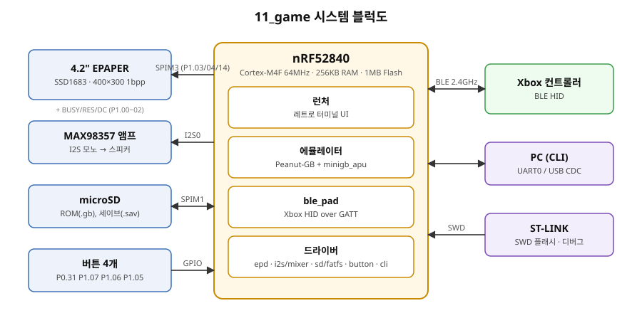

# 02. 하드웨어

## MCU

| 항목 | 값 |
|---|---|
| SoC | nRF52840 (Cortex-M4F, 64MHz, FPU) |
| 모듈 | Nucode NCRB40N02VC |
| Flash | 1MB 내장 (외부 Flash 없음) |
| RAM | 256KB (PSRAM 없음) |
| 무선 | BLE 5 (Xbox 컨트롤러 연결) |

## 4.2" EPAPER (WeAct Studio)

| 항목 | 값 |
|---|---|
| 패널 | 4.2" 흑백 (E042A87), 400×300 |
| 컨트롤러 | SSD1683 |
| 인터페이스 | 4-wire SPI (쓰기 전용) |
| 프레임 크기 | 1bpp, 50바이트 × 300줄 = 15,000바이트 |
| 자료 | https://github.com/WeActStudio/WeActStudio.EpaperModule |

### EPAPER 핀맵 (확장 포트 2×7 헤더)

| EPAPER | nRF52840 | 기능 | DTS |
|---|---|---|---|
| BUSY | P1.00 | 입력, High = 동작 중 | `epd_busy` |
| RES | P1.01 | 리셋 (Low 활성) | `epd_res` |
| DC | P1.02 | Data/Command 선택 | `epd_dc` |
| CS | P1.03 | SPI 칩 선택 | `&spi3` cs-gpios |
| SCL | P1.04 | SPI SCK | `spi3_default` |
| SDA | P1.14 | SPI MOSI | `spi3_default` |

## 주변장치 할당

| 기능 | 장치 | 핀 | 비고 |
|---|---|---|---|
| CLI / 로그 | UART0 | TX P0.06, RX P0.08 | 115200 |
| USB CLI | USBD CDC-ACM | USB | 유지 |
| EPAPER | **SPIM3** | P1.03/04/14 | 유일한 32MHz SPIM. WS2812를 빼서 확보 |
| SD 카드 | SPIM1 | SCK P0.27, MOSI P0.26, MISO P0.04, CS P0.23, CD P1.15 | 8MHz, FatFs |
| 오디오 | I2S0 → MAX98357 | SCK P1.09, LRCK P1.08, SDOUT P0.19, MUTE P1.10 | 모노 앰프 |
| 버튼 4개 | GPIO (gpio-keys) | P0.31, P1.07, P1.06, P1.05 | Active Low, 20ms 디바운스 |
| LED | GPIO | P0.14 | |

### 11_game에서 뺀 장치

| 장치 | 이유 |
|---|---|
| OLED (I2C0, P0.21/22) | EPAPER로 대체. RAM 16KB 절약 |
| PDM 마이크 (P0.05/07) | 사용 안 함. RAM 36KB 절약 |
| WS2812 (SPIM3, P0.20) | SPIM3을 EPAPER에 쓰려고 제거 |

## SPI 인스턴스 정리

nRF52840은 SPIM0/TWIM0, SPIM1/TWIM1이 같은 자원을 공유한다.

| 인스턴스 | 최대 속도 | 용도 |
|---|---|---|
| SPIM0 | 8MHz | 미사용 (I2C0 제거로 비어 있음) |
| SPIM1 | 8MHz | SD 카드 |
| SPIM2 | 8MHz | 미사용 |
| SPIM3 | **32MHz** | EPAPER |

SSD1683의 쓰기 클럭은 데이터시트상 최대 20MHz 안팎이다(Phase 1에서 확인). 처음에는 8MHz로 시작하고 단계적으로 올려 본다.

## 확인 필요

- 회로도에서 EX_P1.03/EX_P1.04 옆에 SWD 라벨이 보인다. 텍스트가 겹쳐 보이는 것인지 실제 연결인지 확인이 필요하다. nRF52840의 SWD는 전용 핀이라 겹칠 가능성은 낮다.
