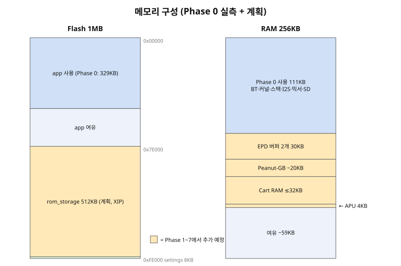
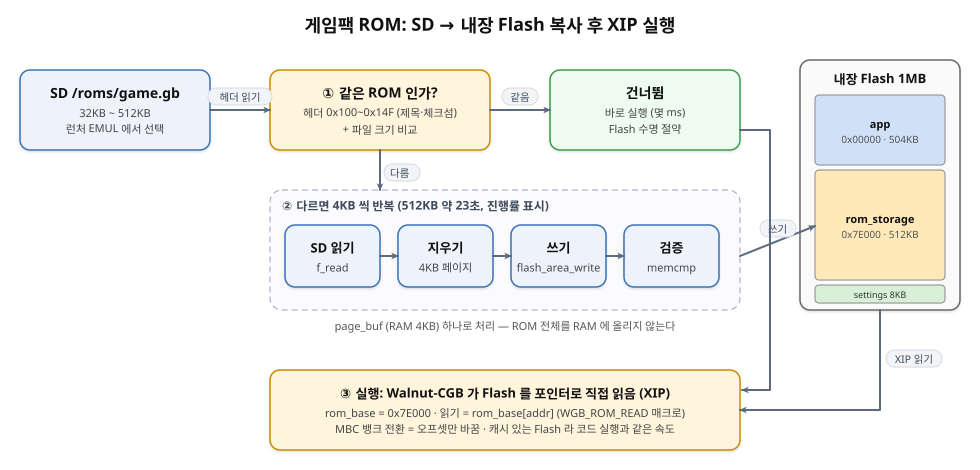

# 03. 메모리 예산

## 최종 사용량 (2026-11-21)

| 항목 | 값 |
|---|---|
| FLASH (app) | **469KB / 504KB (93%)**. 코드 464KB + 초기값 데이터 4KB. RPG 그림·맵·대사 데이터 포함 |
| RAM | **255KB / 256KB (99.5%)**. 정적 할당만 쓴다 (힙 사용 없음) |

### RAM 내역 (`arm-none-eabi-nm --size-sort`)

| 묶음 | 크기 | 주요 항목 |
|---|---|---|
| GB 에뮬레이터 | 약 58KB | cart RAM 32KB, Walnut `struct gb_s` 16.5KB, `lcd_buf` 2bpp 5.6KB, `emu_stack` 4KB |
| 화면 (캔버스 + 회색 모드) | 약 67KB | 캔버스 15KB, `ink_cnt` 펄스 카운터 14.1KB, `ink_black` 마스크 14.1KB, `ink_dv` 받은 펄스 8.4KB, `ink_shade`·`ink_base` 각 5.6KB, `ink_dir` 2.8KB, `disp_stack` 2KB |
| 오디오 | 약 27KB | 믹서 16KB (2채널 × 4096), I2S TX slab 6KB, 오디오 버퍼 1.5KB × 2, I2S 스택 2KB |
| 스레드 스택 | 약 43KB | main(런처) 8KB, 시스템 워크큐 8KB, CLI 8KB, sd_mgr 6KB, 기타 |
| ROM 목록·복사 | 약 7KB | Flash 쓰기 페이지 4KB, ROM 목록 3KB |
| BT·커널·SD·기타 | 약 53KB | SoftDevice Controller 메모리 풀, BT 호스트, FatFs, 커널 |

### RAM 을 더 쓰지 않고 넣은 기능

| 기능 | 방법 |
|---|---|
| RPG (GAMES) | 게임이 실행 중이 아닐 때 `gbRunGetScratch()` 로 `ink_black`(14.1KB)을 빌려 쓴다. 앞 12,800바이트는 RPG 작업 메모리 |
| RPG 음성 재생 | 같은 영역의 12,800바이트 뒤를 FatFs `FIL` 과 스트리밍 버퍼로 쓴다. 출력은 믹서 채널 0 |
| RPG 데이터 | 타일·스프라이트·맵·대사는 `const` 배열로 Flash 에 둔다 (`rpg_assets.h`) |

## Flash 파티션 (`pm_static.yml`)

| 파티션 | 주소 | 크기 | 용도 |
|---|---|---|---|
| app | 0x00000 | 504KB | 펌웨어 |
| rom_storage | 0x7E000 | 512KB | 실행할 GB ROM (SD에서 복사, XIP로 직접 실행) |
| settings_storage | 0xFE000 | 8KB | BT 본딩 정보, 런처 설정 (NVS) |

## 게임팩 ROM: SD → 내장 Flash 복사 (`gb/gb_rom.c`)

GB ROM 은 최대 512KB 라 RAM(256KB)에 올릴 수 없다. 그래서 SD 카드의 ROM 을 내장 Flash 의 `rom_storage` 파티션에 복사해 두고, 에뮬레이터가 Flash 를 메모리처럼 직접 읽는다(XIP).

| 단계 | 내용 |
|---|---|
| ① 같은 ROM 확인 | SD 파일의 헤더 0x100~0x14F (로고·제목·헤더/전역 체크섬)와 파일 크기를 Flash 에 있는 ROM 과 비교한다. 같으면 복사를 건너뛰고 바로 실행한다. 같은 게임을 다시 할 때 기다리지 않고 Flash 쓰기 횟수(수명)도 아낀다 |
| ② 복사 | 4KB 씩 SD 읽기 → Flash 페이지 지우기 → 쓰기 → `memcmp` 검증. RAM 은 `page_buf` 4KB 하나만 쓴다. 512KB 약 23초, 런처에 진행률 표시. `gb load <번호> force` 는 같아도 다시 쓴다 |
| ③ 실행 | `rom_base = 0x7E000`. 코어의 ROM 읽기는 콜백 대신 `rom_base[addr]` 포인터 읽기 매크로(`WGB_ROM_READ`/`16`/`32`)라 함수 호출이 없다 (Donkey Kong 기준 약 5% 빨라짐). MBC 뱅크 전환은 읽는 오프셋만 바뀐다 |

| 제약 | 내용 |
|---|---|
| 크기 | 32KB ~ 512KB (`size error` 로 거부). 1MB 이상 게임(포켓몬 등)은 지원하지 않는다 |
| 세이브 | ROM 과 별도로 cart RAM(최대 32KB)을 RAM 에 두고 SD `/saves/<rom>.sav` 로 저장한다 (05 문서) |
| 오류 | `file open fail` / `file read fail` / `flash write fail` / `verify fail` 을 런처와 CLI 에 표시한다 |

## 줄인 항목 (Phase 0, 10_xbox 대비)

| 항목 | 10_xbox | 11_game |
|---|---|---|
| PDM 마이크 버퍼·스택 | 36KB | 제거 |
| OLED 프레임버퍼·폰트 버퍼 | 16KB | 제거 |
| 로그 부트·리스트 버퍼 | 8KB | 2KB (`HW_LOG_*_BUF_MAX` 1024) |
| I2S TX slab | 12KB (16개) | 6KB (8개) |
| 믹서 | 4채널, 12KB | 2채널, 16KB (버퍼를 늘려 에뮬 프레임 지연 흡수) |
| WS2812, I2C 드라이버 | 사용 | 제거 |
| USB CDC (Phase 8) | 사용 | 제거, 9.5KB 확보 |

## 사용량 변화

| 시점 | FLASH (app) | RAM | 내용 |
|---|---|---|---|
| Phase 0 | 329KB | 111KB | 골격 (필요한 모듈만) |
| Phase 3 | 407KB | 186KB | Walnut-CGB, cart RAM, LCD 버퍼 |
| Phase 8 | 429KB | 252KB | 회색 모드 버퍼(카운터·마스크·이력), 22kHz 사운드 |
| 최종 | 469KB | 255KB | 런처 키 이벤트 큐, RPG (데이터는 Flash, 작업 메모리는 빌려 씀) |

RAM 여유가 약 1KB 라 새 기능은 기존 버퍼를 빌려 쓰는 방식으로 넣어야 한다. 더 필요하면 스레드 스택(Thread analyzer 로 실측 후)이나 믹서 버퍼를 줄이는 것이 다음 후보다.
