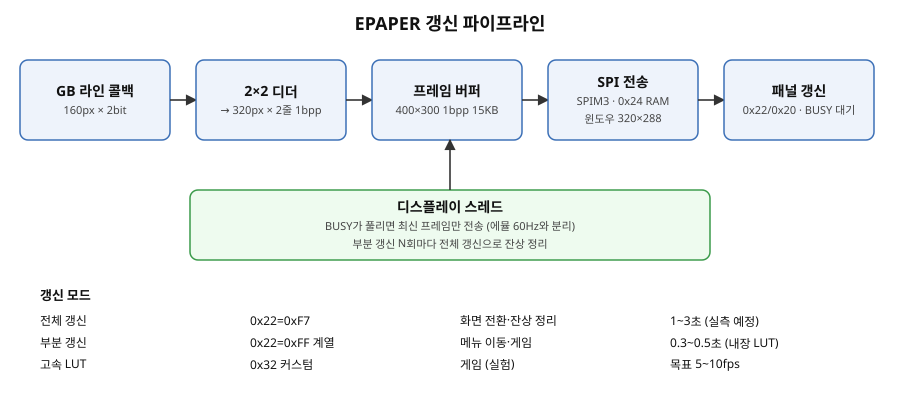
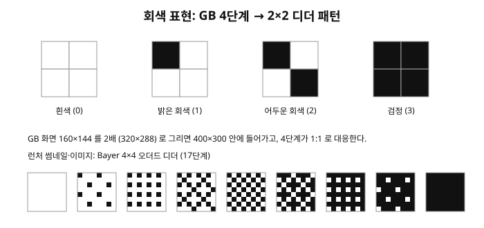

# 04. EPAPER 드라이버와 회색 표현



## SSD1683 기본

| 항목 | 내용 |
|---|---|
| 해상도 | 400×300, 1bpp (0xFF = 흰색) |
| RAM | 0x24 = 새 이미지(B/W), 0x26 = 이전 이미지(부분 갱신 시 비교용) |
| 윈도우 | 0x44 (X 바이트 범위), 0x45 (Y 범위), 0x4E/0x4F (주소 카운터) |
| 갱신 | 0x22 (Display Update Control 2) 설정 → 0x20 (Master Activation) → BUSY 대기 |
| LUT | 0x32로 MCU에서 웨이브폼 직접 로드 가능 |
| 온도 | 0x18 (센서 선택), 0x1A (온도값 쓰기) → 내장 웨이브폼 선택에 영향 |

### WeAct 예제 초기화 순서 (시작점)

```
HW reset → 0x12 (SW reset) → BUSY 대기
0x01 2B 01 00   ; Driver output, 300 gates
0x11 01         ; X 증가, Y 감소
0x44 00 31      ; X 0..49 바이트
0x45 2B 01 00 00; Y 299..0
0x3C 01         ; Border
0x21 40         ; Display update control 1
0x4E 00 / 0x4F 2B 01
0x24 <15000 bytes>
0x22 F7 → 0x20 → BUSY 대기   ; 전체 갱신 (내장 웨이브폼)
```

## Phase 1 측정 결과 (2026-11-20)

| 항목 | 측정값 | 비고 |
|---|---|---|
| 전체 갱신 (0x22=0xF7) | **BUSY 2,776ms**, 합계 2.8초 | 0x24 + 0x26 각 15KB 전송 30.8ms |
| 부분 갱신 (0x21=0x00, 0x22=0xFC) | **BUSY 565ms, 1.66fps** | 내장 웨이브폼, 0x24 15KB 전송 15.3ms |
| SPI | SPIM3 8MHz | 15KB 약 15ms |
| 화면 방향 | Data entry 0x11=0x03 (X·Y 증가)에서 정상 | WeAct 예제(0x01, Y 감소)와 다르게 써도 문제없음 |
| GB 2×2 4단계 | 육안으로 4단계 모두 구분됨 | 게임 화면 방식으로 확정 |

## Phase 2 결과: 고속 갱신 (2026-11-20)

### 데이터시트에서 확인한 사실 (SSD1683 Rev 1.0)

| 항목 | 내용 |
|---|---|
| 0x22 bit3 | "디스플레이 모드 2"가 아니라 **흑백(B/W) 모드 LUT 선택**. 0xF7 = 3색 모드 전체, 0xFF = 흑백 모드 전체 |
| 0x22 주요 값 | 0x99 흑백 LUT 로드만, 0xCF 로드 없이 흑백 표시 후 전원 끔, 0x03 아날로그·클럭 끔 |
| 0x32 LUT | 227바이트. 흑백 모드 배치: LUTC 0, LUTWW 42, LUTBW 84, LUTWB 126, LUTBB 168 (각 6그룹 × 7바이트 `[RP][VS\|TP A~D][SR AB][SR CD]`), 224 FR, 225~226 XON |
| VS 값 | 00 VSS, 01 VSH1, 10 VSL, 11 VSH2. TP는 0~63 프레임, SR/RP = 0이면 건너뜀 |
| FR (224) | 하위 4bit만 사용. 0x05 = 125Hz (프레임 8ms) |
| RAM 전환 | R RAM(이전) / BW RAM(새) 조합으로 LUT 선택: 1,0 → LUTBW (흰→검), 0,1 → LUTWB (검→흰) |
| 0x0C 소프트 스타트 | 기본 0x0F = 40 + 40 + 10ms. 갱신마다 붙는 고정 오버헤드의 주원인 |

### 실험 결과

| 시도 | BUSY | fps | 판단 |
|---|---|---|---|
| 내장 부분 갱신 0xFC | 565ms | 1.66 | 기준 |
| 흑백 전체 갱신 0xFF | 666ms | — | 3색 전체(2,776ms)보다 4배 빠름 → FULL 기본값으로 변경 |
| 온도 트릭 (0x1A 40~100°C + 0x99) | 964ms | 1.0 | 오히려 느림 → 제외 |
| 커스텀 LUT 10프레임, 0xCF | 233ms | 3.7 | |
| + 아날로그 유지 0xCC | 192ms | 4.4 | |
| + 소프트 스타트 30ms + 재활성화 생략 0x8C | 97ms | 7.6 | |
| + SPI 16MHz | 99ms | **8.4** | **FAST 모드 확정** |
| 펄스 3프레임, SPI 32MHz | 28ms | 24.6 | 많이 회색, 32MHz는 비트 오류 |

- 펄스 4프레임만 주면 픽셀이 덜 구동되어 회색이 된다(Hackaday 회색 원리와 같음). 잔상도 많이 남는다.
- **hold**: 색이 그대로인 픽셀(WW, BB)도 같은 시간만큼 목표색으로 구동하면 잔상이 프레임마다 지워지고 글자 겹침이 사라진다. 모든 픽셀이 병렬로 구동되므로 시간은 늘지 않는다.
- 10프레임 펄스 한 번으로는 완전한 검정이 아니다. 정지한 부분은 hold로 몇 프레임 안에 진해진다.

### 주의 사항 (실험 중 발견)

| 현상 | 원인 | 대응 |
|---|---|---|
| 배경에 점이 남음 | EOPT 0x07(방전 생략, VCOM 플로팅)과 ±17V 전압 실험 후 잔류 | 둘 다 제외하고 OTP 값 사용. `epd clean`(3색 검정/흰색 반복)으로 회복됨 |
| 32MHz에서 무작위 점 | SPI 비트 오류 (글자 모양은 유지) | SPI 16MHz 확정 (`spi-max-frequency`) |
| FAST 후 전체 갱신이 약함 | 소프트 스타트 30ms 설정이 OTP LUT 로드로 복구되지 않음 | FULL/PART로 바뀔 때 0x0C를 기본값으로 자동 복구 |
| SPI 클럭 변경이 적용 안 됨 | Zephyr spi_nrfx는 `spi_config` 포인터가 바뀔 때만 재설정 | `spi_dt_spec` 2개를 번갈아 사용 |

### 확정된 갱신 모드

| 모드 | 설정 | 시간 | 용도 |
|---|---|---|---|
| `EPD_MODE_FULL` | 0x21=0x40, 0x22=0xFF | 0.68초 | 화면 전환, 잔상 정리 |
| `EPD_MODE_PART` | 0x21=0x00, 0x22=0xFC (OTP 웨이브폼) | 0.6초 | 런처 (화질 우선) |
| `EPD_MODE_FAST` | 커스텀 LUT(전환 10, hold 10, FR 125Hz), 소프트 스타트 30ms, 첫 갱신 0xCC 이후 0x8C | **0.12초 (8.4fps)** | 게임 |
| `epd clean` | 3색 전체(0xF7)로 검정/흰색 반복 | 약 11초 | 점·잔상 복구 |

FAST 모드는 아날로그 전원을 켜 둔 채로 유지한다. 게임을 끝낼 때 `epdPowerOff()`(0x22=0x03)를 호출한다.

### 더 빠르게 하려면 (남은 여지)

- 게임 영역(320×288)만 윈도우 전송: SPI 15.6ms → 11.5ms
- RAM Ping-Pong(0x37, F[6]=1)으로 이전 이미지(0x26) 쓰기 생략: 전송 절반
- 펄스 5프레임 = 약 13fps, 3프레임 = 약 20fps (화질 저하). 게임 설정에서 고를 수 있게 한다.

## 갱신 전략

| 모드 | 용도 | 예상 시간 |
|---|---|---|
| 전체 갱신 (0x22=0xFF) | 화면 전환, 잔상 정리 | 0.68초 |
| 부분 갱신 (0x22=0xFC) / FAST (커스텀 LUT) | 메뉴 이동 / 게임 화면 | 0.6초 / 0.12초 (Phase 2 결과 참고) |
| 윈도우 부분 갱신 | 게임 영역 320×288만 | SPI 전송량 11.5KB |

SPI 전송 시간은 SPIM3 8MHz 기준으로 15KB에 약 15ms, 16MHz면 약 8ms이다. 병목은 패널 갱신 시간이다.

### 잔상(고스팅) 관리

- 부분 갱신을 N번 하면 전체 갱신을 한 번 한다(N은 CLI·설정으로 조절).
- 큰 검은 영역은 잔상이 잘 남는다. UI는 흰 배경 위주로 만든다.

## Hackaday 30fps 기법 검토

출처: https://hackaday.com/2026/10/14/tiny-e-paper-display-delivers-30-fps-of-game-boy-fun/

| 항목 | 내용 |
|---|---|
| 하드웨어 | Waveshare ESP32-S3-ePaper-1.54 (1.54" 패널) |
| 원리 | 픽셀마다 변화량에 맞춰 최대 8펄스만 짧게 구동하는 커스텀 웨이브폼 |
| 회색 | 일부러 덜 구동(under-drive)해 4단계 회색을 만듦 |
| 보정 | 색 전환 종류별로 타이밍을 영상 촬영으로 보정 |
| 공개 여부 | 소스 미공개 (추후 공개 예정) |

**적용 판단**
- SSD1683도 0x32 커스텀 LUT와 부분 갱신을 지원하므로 같은 방향으로 시도할 수 있다.
- 4.2"는 면적이 약 7배이고 전송량도 커서 30fps는 비현실적이다. **목표는 5~10fps**이고 Phase 2에서 실측한다.
- 빠른 웨이브폼은 잔상과 패널 수명에 영향이 있다. 주기적 전체 갱신으로 완화한다.

## 회색 표현 (디더링)



| 방식 | 내용 | 용도 |
|---|---|---|
| 2×2 블록 디더 | GB 픽셀 1개 → 2×2 화소. 흰/밝은회색/어두운회색/검정 = 0/1/2/4 dot | 게임 화면 (160×144 → 320×288) |
| Bayer 4×4 | 8bit 밝기 → 1bit, 17단계 | 런처 썸네일, 이미지 |
| 웨이브폼 회색 | 0x24/0x26 조합과 짧은 펄스 LUT로 실제 회색 구동 | Phase 2 실험 |

GB 화면을 2배로 키우면 320×288이 400×300 안에 들어간다. 2×2 패턴 4단계가 GB의 4단계 회색과 1:1로 맞는다.

## 구현 (Phase 1)

| 파일 | 역할 |
|---|---|
| `src/hw/driver/epd/ssd1683.c` | SPI(Zephyr `spi_dt_spec`, `epd_spi` 노드)와 BUSY/RES/DC 핀, 명령·RAM 쓰기, 윈도우 설정 |
| `src/hw/driver/epd.c` | 패널 초기화, 전체·부분 갱신(윈도우 지원), 시간 측정, CLI `epd` |
| `src/hw/driver/canvas.c` | 1bpp 400×300 버퍼(15KB), 점·선·박스, 8×16 영문/16×16 한글(`hangul` 폰트), Bayer 4×4, GB 2×2 패턴 |

```c
bool epdInit(void);
bool epdUpdate(epd_mode_t mode);                                   // EPD_MODE_FULL / EPD_MODE_PART
bool epdUpdateWindow(epd_mode_t mode, uint16_t x, uint16_t y, uint16_t w, uint16_t h);
bool epdIsBusy(void);
void epdGetTime(epd_time_t *p_time);                               // spi_us, busy_ms, total_ms

uint8_t *canvasGetBuffer(void);
void     canvasClear(canvas_color_t color);
int16_t  canvasPrintf(int16_t x, int16_t y, canvas_color_t color, const char *fmt, ...);
void     canvasDrawGray(int16_t x, int16_t y, uint8_t gray);      // Bayer 4x4
void     canvasDrawGb2x2(int16_t x, int16_t y, uint8_t shade);     // GB 4단계
```

| CLI | 동작 |
|---|---|
| `epd info` | 상태, SPI 속도, 마지막 갱신 시간 |
| `epd clear [full\|part]` | 흰 화면 |
| `epd test 0~3 [full\|part]` | 0 체커, 1 Bayer 그라데이션, 2 GB 4단계, 3 텍스트 |
| `epd text <str>` | 문자열 출력 |
| `epd spi <MHz>` | SPI 클럭 변경 |
| `epd bench <n> [full\|part]` | 연속 갱신 fps 측정 |
| `epd sleep` | 딥슬립 |
| `epd fast <frames> <hold>` | FAST 모드 LUT 설정 |
| `epd off` | 아날로그 전원 끄기 |
| `epd clean [n]` | 검정/흰색 3색 전체 갱신 반복 (잔상·점 복구) |
| `epd ctrl [full\|part] <hex>` | 0x22 값 변경 (실험용) |
| `epd lut <frames> [hold vs_b vs_w fr]` | 커스텀 LUT 직접 쓰기 (실험용) |
| `epd temp <C>` | 온도 강제 + LUT 로드 (실험용, 효과 없음) |
| `epd cmd <hex> [data...]` | 레지스터 직접 쓰기 (실험용) |

부분 갱신 순서: 0x24에 새 이미지 → 0x21=0x00 → 0x22=0xFC → 0x20 → BUSY 대기 → 0x26에 같은 이미지(다음 차분 기준).
