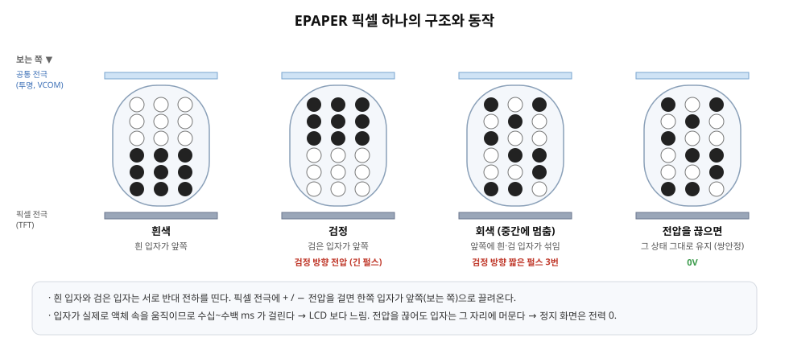
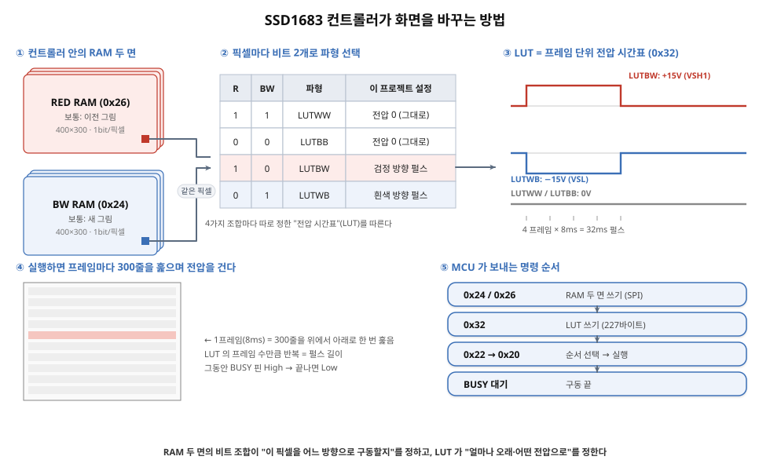
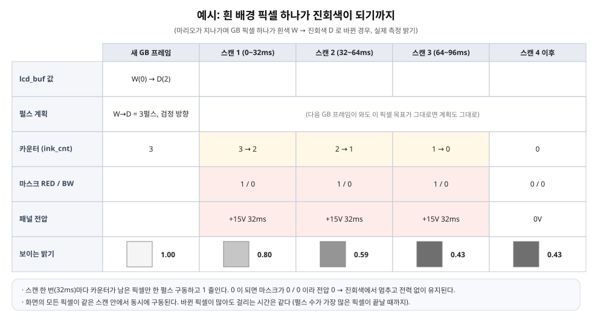

# 04. EPAPER 드라이버와 회색 표현

## EPAPER 동작 원리 (처음 보는 사람을 위해)

### 1. 픽셀 하나의 구조



EPAPER 의 픽셀은 작은 캡슐(또는 칸)이다. 안에는 투명한 액체와 **흰 입자, 검은 입자**가 들어 있고, 두 입자는 서로 반대 전하를 띤다. 캡슐 위에는 화면 전체가 공유하는 투명 전극(VCOM)이, 아래에는 픽셀마다 따로 있는 전극(TFT)이 있다.

| 성질 | 내용 | 이 프로젝트에 미치는 영향 |
|---|---|---|
| 전압으로 입자를 민다 | 픽셀 전극에 한쪽 전압을 걸면 검은 입자가, 반대 전압을 걸면 흰 입자가 앞쪽으로 온다 | 픽셀마다 "검정 방향 / 흰색 방향 / 구동 안 함" 셋 중 하나를 고른다 |
| 느리다 | 입자가 액체 속을 실제로 움직이므로 끝까지 가는 데 수백 ms 가 걸린다 | LCD 처럼 60fps 는 불가능. 게임 화면은 32ms 스캔 단위로 조금씩 움직인다 |
| 쌍안정 | 전압을 끊어도 입자가 그 자리에 머문다 | 정지 화면은 전력 0. 반대로 **아무 것도 안 하면 이전 그림이 그대로 남는다** |
| 중간에 세울 수 있다 | 짧은 펄스를 몇 번만 주면 입자가 중간까지만 와서 회색이 된다 | 회색 모드: 펄스 수 = 밝기 |
| 이력이 남는다 | 같은 펄스라도 입자가 어디서 출발했는지, 얼마나 머물렀는지에 따라 움직이는 양이 다르다 | 잔상의 원인. 이력 모델과 카메라 캘리브레이션(10 문서)으로 보정 |
| 전압 균형이 필요하다 | 한쪽 방향 전압(DC)이 오래 쌓이면 패널 안에 전하가 갇혀 그림이 배어 나온다 | 정지 화면에는 전압을 걸지 않고, 검정·흰색 방향 펄스 수를 맞춘다 |

### 2. 웨이브폼 (LUT): 전압 시간표

화면을 바꿀 때 픽셀에 "어떤 전압을, 몇 프레임 동안, 몇 번" 걸지 정한 시간표를 **웨이브폼**이라 하고, 컨트롤러 안에서는 **LUT**(Look-Up Table)로 저장한다.

| 종류 | 내용 | 결과 |
|---|---|---|
| 공장 웨이브폼 (OTP) | 패널 제조사가 온도별로 넣어 둔 것. 검정·흰색으로 여러 번 흔든 뒤 목표 색으로 보낸다 | 이전 상태를 지우고 기준을 맞추므로 잔상이 없다. 대신 깜빡이고 오래 걸린다 (F7 2.8초) |
| 커스텀 LUT (0x32) | MCU 가 직접 써 넣는 시간표. 이 프로젝트는 "한 방향으로 짧게 한 번"만 정의 | 빠르다 (32ms). 흔들기가 없어 이력이 남으므로 펄스 수를 정교하게 계산해야 한다 |

"전체 갱신"은 모든 픽셀에 공장 웨이브폼을 돌려 깨끗이 정리하는 것이고, "부분 갱신·빠른 갱신"은 바뀐 픽셀만 짧게 구동하는 것이다. EPAPER 제품들은 두 가지를 섞어 쓴다 (빠른 갱신을 여러 번 하다가 가끔 전체 갱신).

### 3. 컨트롤러(SSD1683)가 화면을 바꾸는 방법



1. **RAM 두 면:** 컨트롤러 안에 픽셀당 1비트짜리 RAM 이 두 면 있다. 보통은 RED RAM(0x26)에 이전 그림, BW RAM(0x24)에 새 그림을 넣는다.
2. **파형 선택:** 픽셀마다 두 RAM 의 비트 조합(2비트 = 4가지)으로 LUT 네 개 중 하나를 고른다. 이전과 새 그림이 같으면 LUTWW/LUTBB(이 프로젝트는 전압 0), 다르면 LUTBW(검정 방향) 또는 LUTWB(흰색 방향).
3. **LUT:** 각 파형이 프레임 단위로 어떤 전압(+15V, −15V, 0V)을 걸지 정한다. 이 프로젝트는 프레임 8ms(125Hz)이고, 게임용 펄스는 4프레임 = 32ms.
4. **스캔:** 실행 명령(0x20)을 받으면 컨트롤러가 프레임마다 300줄을 위에서 아래로 훑으며 모든 픽셀에 동시에 전압을 건다. 그동안 BUSY 핀이 High 다.
5. **MCU 쪽 순서:** RAM 쓰기(SPI) → LUT 쓰기 → 0x22 로 순서 선택 → 0x20 실행 → BUSY 가 Low 가 될 때까지 대기.

이 프로젝트의 게임 화면은 RAM 두 면을 "이전·새 그림"이 아니라 **"검정으로 밀 픽셀 / 흰색으로 밀 픽셀" 마스크**로 쓴다. RED=1·BW=0 이면 검정 방향, RED=0·BW=1 이면 흰색 방향, 둘 다 0 이면 구동하지 않는다. 그래서 MCU 가 픽셀마다 이번 스캔에서 할 일을 직접 정할 수 있다 (`epdUpdateMask`).

### 4. 용어

| 용어 | 뜻 |
|---|---|
| 펄스 | 한 방향 전압을 정해진 시간 거는 것. 이 프로젝트 게임 화면은 32ms |
| 프레임 | 컨트롤러가 300줄을 한 번 훑는 단위 (8ms). LUT 의 시간 단위 |
| 스캔 | `epdUpdateMask` 한 번 = 펄스 하나를 화면 전체에 동시에 거는 것 |
| 전체 갱신 | 모든 픽셀을 공장 웨이브폼으로 정리 (F7 3색 2.8초, 저온 흑백 1.25초 등) |
| 부분·빠른 갱신 | 바뀐 픽셀만 구동 (공장 부분 0.6초, 커스텀 FAST 0.1~0.4초) |
| 잔상 (고스팅) | 이전 그림이 옅게 비치는 것. 입자가 목표보다 덜 가거나 더 가서 생긴다 |
| hold | 바뀌지 않은 픽셀도 같은 색으로 계속 구동하는 것. 선명해지지만 DC 가 쌓여 이 프로젝트에서는 끔 (hold 0) |
| VCOM | 화면 전체가 공유하는 앞쪽 공통 전극의 전압 |
| BUSY | 컨트롤러가 구동 중임을 알리는 핀. 끝나야 다음 명령을 보낼 수 있다 |
| 아날로그 전원 | ±15V 를 만드는 승압 회로. 켜는 데 시간이 걸려 게임 중에는 켜 둔다 |

## 갱신 파이프라인: 게임 화면이 그려지는 단계


에뮬레이터(60fps)와 패널(스캔 32ms)은 속도가 다르다. 그래서 둘 사이에 "픽셀마다 앞으로 몇 펄스를 더 줘야 하는지"를 기억하는 카운터를 두고, 패널은 그 카운터만 보고 스캔을 계속한다. 에뮬레이터가 빨라지거나 느려져도 화면 쪽은 영향을 받지 않는다.

| 단계 | 하는 일 | 코드 (`gb/gb_run.c`) | 결과 |
|---|---|---|---|
| 1. 새 프레임 | 에뮬레이터가 GB 화면 160×144 를 2비트(4단계)로 그린다. 디스플레이 스레드가 받을 준비가 됐을 때만 그린다 (약 83ms 간격) | `lcd_buf`, `gb_emu` 스레드 | 픽셀마다 새 목표 W/L/D/K |
| 2. 펄스 계획 | 이전 목표와 비교해 바뀐 픽셀마다 출발 색 → 목표 색 표(`gray_dose`)로 펄스 수를 정한다. 그 픽셀이 지금까지 받은 펄스, 머문 시간, 테두리·선 여부로 보정한다 (이력 모델). 40% 이상 바뀌면 장면 전환으로 보고 F7 전체 갱신 | `inkPlan()`, `ink_shade`, `ink_dv`, `ink_dir` | 픽셀마다 "검정/흰색 방향으로 N 펄스" |
| 3. 카운터 | N 을 픽셀별 5비트 카운터에 넣는다. 32픽셀을 한 번에 계산하도록 비트별로 나눠 저장(비트 슬라이스) | `ink_cnt` | 남은 펄스 수 |
| 4. 스캔 마스크 | 카운터가 0 보다 큰 픽셀만 방향에 따라 검정 마스크 또는 흰색 마스크 비트를 1 로 하고, GB 픽셀 1개를 화면 2×2 로 키운다. 바뀐 줄 범위만 기록 | `ink_black`, `inkWhiteBuf()` | 이번 스캔에 구동할 픽셀 목록 |
| 5. 전송·구동 | RED RAM 에 검정 마스크, BW RAM 에 흰색 마스크를 보내고(SPIM2, 4KB 씩) 커스텀 LUT 로 한 번 스캔한다 | `epdUpdateMask()` (`epd.c`) | 표시된 픽셀만 32ms 펄스 하나 |
| 6. 반복·정지 | 구동한 픽셀의 카운터를 1 줄이고 4 로 돌아간다. 모든 카운터가 0 이면 스캔하지 않는다 | 디스플레이 스레드 루프 | 목표 밝기에서 멈춤, 정지 화면 전력 0 |



이 구조의 장점:

- **바뀐 픽셀만 구동한다.** 움직이는 부분만 빠르게 바뀌고, 정지 화면에는 전압이 걸리지 않아 패널이 상하지 않는다 (hold 구동으로 생겼던 패널 잔상 문제를 막는다).
- **모든 픽셀이 같은 스캔에서 동시에 움직인다.** 화면의 절반이 바뀌어도 한 픽셀이 바뀌어도 스캔 한 번의 시간은 같다.
- **새 프레임이 중간에 와도 된다.** 아직 끝나지 않은 픽셀의 목표가 바뀌면 2단계에서 그 픽셀이 지금까지 받은 펄스를 반영해 방향과 펄스 수를 다시 계산한다.

## 최종 구성 (2026-11-21)

| 항목 | 내용 |
|---|---|
| 연결 | SPIM2 8MHz (02 문서). 15KB 전송 약 15ms, 4KB 씩 나눠 DMA |
| 게임 화면 | **회색 모드 마스크 구동.** 픽셀별 이력 모델로 펄스 수를 정하고(10 문서), 5bit 카운터가 남은 픽셀만 스캔(32ms)마다 한 펄스씩 구동. 정지 화면에는 전압을 걸지 않음 |
| 게임 중 전체 갱신 | 3색 웨이브폼 F7 (`epdUpdateStrong`). 장면 전환(GB 픽셀 40% 이상 바뀜)·정리 때. 약한 갱신을 섞으면 구동 전압 상태가 달라져 회색이 흔들려 F7 로 통일 |
| 런처 | 메뉴 이동 FAST 45프레임(약 0.4초, hold 0), 화면 전환·10회째·멈춘 뒤 5초에 저온 전체 갱신(10°C, 1.25초), 부팅·게임 종료 뒤 F7 |
| RPG (앱 API) | 걷기 QUICK 8프레임(약 0.1초), 대화·메뉴 FAST 45, 방 이동·전투 시작·대화 닫기 FLASH(약 1.2초) |
| 전원 | FAST·마스크 구동 동안 아날로그 전원 유지, 입력이 60초 없으면 끔. 다시 켤 때 0xC0 → 20ms → 0x8C 순서 |

아래는 단계별 기록이다. 측정값은 당시 설정(SPI 속도 등) 기준이다.

## SSD1683 기본

| 항목 | 내용 |
|---|---|
| 해상도 | 400×300, 1bpp (0xFF = 흰색) |
| RAM | 0x24 = 새 이미지(B/W), 0x26 = 이전 이미지(부분 갱신 시 비교용) |
| 윈도우 | 0x44 (X 바이트 범위), 0x45 (Y 범위), 0x4E/0x4F (주소 카운터) |
| 갱신 | 0x22 (Display Update Control 2) 설정 → 0x20 (Master Activation) → BUSY 대기 |
| LUT | 0x32로 MCU에서 웨이브폼 직접 로드 가능 |
| 온도 | 0x18 (센서 선택), 0x1A (온도값 쓰기) → 내장 웨이브폼 선택에 영향 |

### WeAct 예제 초기화 순서 (시작점)

```
HW reset → 0x12 (SW reset) → BUSY 대기
0x01 2B 01 00   ; Driver output, 300 gates
0x11 01         ; X 증가, Y 감소
0x44 00 31      ; X 0..49 바이트
0x45 2B 01 00 00; Y 299..0
0x3C 01         ; Border
0x21 40         ; Display update control 1
0x4E 00 / 0x4F 2B 01
0x24 <15000 bytes>
0x22 F7 → 0x20 → BUSY 대기   ; 전체 갱신 (내장 웨이브폼)
```

## Phase 1 측정 결과 (2026-11-20)

| 항목 | 측정값 | 비고 |
|---|---|---|
| 전체 갱신 (0x22=0xF7) | **BUSY 2,776ms**, 합계 2.8초 | 0x24 + 0x26 각 15KB 전송 30.8ms |
| 부분 갱신 (0x21=0x00, 0x22=0xFC) | **BUSY 565ms, 1.66fps** | 내장 웨이브폼, 0x24 15KB 전송 15.3ms |
| SPI | 8MHz (당시 SPIM3, 최종 SPIM2) | 15KB 약 15ms |
| 화면 방향 | Data entry 0x11=0x03 (X·Y 증가)에서 정상 | WeAct 예제(0x01, Y 감소)와 다르게 써도 문제없음 |
| GB 2×2 4단계 | 육안으로 4단계 모두 구분됨 | 게임 화면 방식으로 확정 |

## Phase 2 결과: 고속 갱신 (2026-11-20)

### 데이터시트에서 확인한 사실 (SSD1683 Rev 1.0)

| 항목 | 내용 |
|---|---|
| 0x22 bit3 | "디스플레이 모드 2"가 아니라 **흑백(B/W) 모드 LUT 선택**. 0xF7 = 3색 모드 전체, 0xFF = 흑백 모드 전체 |
| 0x22 주요 값 | 0x99 흑백 LUT 로드만, 0xCF 로드 없이 흑백 표시 후 전원 끔, 0x03 아날로그·클럭 끔 |
| 0x32 LUT | 227바이트. 흑백 모드 배치: LUTC 0, LUTWW 42, LUTBW 84, LUTWB 126, LUTBB 168 (각 6그룹 × 7바이트 `[RP][VS\|TP A~D][SR AB][SR CD]`), 224 FR, 225~226 XON |
| VS 값 | 00 VSS, 01 VSH1, 10 VSL, 11 VSH2. TP는 0~63 프레임, SR/RP = 0이면 건너뜀 |
| FR (224) | 하위 4bit만 사용. 0x05 = 125Hz (프레임 8ms) |
| RAM 전환 | R RAM(이전) / BW RAM(새) 조합으로 LUT 선택: 1,0 → LUTBW (흰→검), 0,1 → LUTWB (검→흰) |
| 0x0C 소프트 스타트 | 기본 0x0F = 40 + 40 + 10ms. 갱신마다 붙는 고정 오버헤드의 주원인 |

### 실험 결과

| 시도 | BUSY | fps | 판단 |
|---|---|---|---|
| 내장 부분 갱신 0xFC | 565ms | 1.66 | 기준 |
| 흑백 전체 갱신 0xFF | 666ms | — | 3색 전체(2,776ms)보다 4배 빠름 → FULL 기본값으로 변경 |
| 온도 트릭 (0x1A 40~100°C + 0x99) | 964ms | 1.0 | 오히려 느림 → 제외 |
| 커스텀 LUT 10프레임, 0xCF | 233ms | 3.7 | |
| + 아날로그 유지 0xCC | 192ms | 4.4 | |
| + 소프트 스타트 30ms + 재활성화 생략 0x8C | 97ms | 7.6 | |
| + SPI 16MHz | 99ms | **8.4** | FAST 모드 확정 (SPI 는 나중에 8MHz 로 되돌림) |
| 펄스 3프레임, SPI 32MHz | 28ms | 24.6 | 많이 회색, 32MHz는 비트 오류 |

- 펄스 4프레임만 주면 픽셀이 덜 구동되어 회색이 된다(Hackaday 회색 원리와 같음). 잔상도 많이 남는다.
- **hold**: 색이 그대로인 픽셀(WW, BB)도 같은 시간만큼 목표색으로 구동하면 잔상이 프레임마다 지워지고 글자 겹침이 사라진다. 모든 픽셀이 병렬로 구동되므로 시간은 늘지 않는다.
- 10프레임 펄스 한 번으로는 완전한 검정이 아니다. 정지한 부분은 hold로 몇 프레임 안에 진해진다.

### 주의 사항 (실험 중 발견)

| 현상 | 원인 | 대응 |
|---|---|---|
| 배경에 점이 남음 | EOPT 0x07(방전 생략, VCOM 플로팅)과 ±17V 전압 실험 후 잔류 | 둘 다 제외하고 OTP 값 사용. `epd clean`(3색 검정/흰색 반복)으로 회복됨 |
| 32MHz에서 무작위 점 | SPI 비트 오류 (글자 모양은 유지) | 당시 16MHz 로 정함 → Phase 8 에서 SPIM2 8MHz 로 최종 변경 (02 문서) |
| FAST 후 전체 갱신이 약함 | 소프트 스타트 30ms 설정이 OTP LUT 로드로 복구되지 않음 | FULL/PART로 바뀔 때 0x0C를 기본값으로 자동 복구 |
| SPI 클럭 변경이 적용 안 됨 | Zephyr spi_nrfx는 `spi_config` 포인터가 바뀔 때만 재설정 | `spi_dt_spec` 2개를 번갈아 사용 |

### Phase 7 에서 수정: hold 구동 끔 (패널 잔상)

- FAST 모드의 hold(변하지 않은 픽셀도 목표색으로 구동)는 정지 화면에도 같은 방향 전압을 초당 수 회 계속 걸어 **DC 가 누적**된다.
  게임을 오래 한 뒤 배경이 회색이 되고 마리오 화면이 다른 화면 위에 겹쳐 보였으며, 3색 검정/흰색 정리를 반복해도 옅게 남았다.
- InkBoy 는 변하지 않은 픽셀을 HOLD(전압 0) 로 두고, 바뀐 픽셀만 픽셀별 카운터로 정해진 횟수(기본 8)만 구동한다.
- 수정: 게임 FAST 의 hold = 0 (기본값). 런처는 공장 웨이브폼(PART/FULL)만 사용.
- 근본 해결은 Phase 8 의 픽셀별 펄스 카운터 (InkBoy 방식).
- BUSY 가 가끔 풀리지 않는 현상 → `epdRecover()` 로 하드웨어 리셋 후 계속.

### 패널 잔상과 대비 저하 (Phase 8 기록)

- 원인: Phase 4~6 의 FAST hold 구동이 정지 화면에도 같은 방향 전압을 초당 약 7회(80ms 씩) 계속 걸었다. 정지 화면에서도 1초 중 약 0.5초 DC 가 걸린 셈이고, 게임을 수십 분 하는 동안 Super Mario Land 의 타이틀·1-1·HUD·땅 위치에 DC 가 쌓였다.
- 결과: 패널 내부 전하가 갇혀 (1) 다른 화면을 그려도 마리오 배경이 떠오르고 (2) 같은 웨이브폼으로도 검정이 덜 진해졌다. 3색 전체 갱신 4단계 테스트에서 처음(Phase 1)보다 검정이 옅게 나온다.
- 시도:

| 방법 | 결과 |
|---|---|
| `epd clean` (3색 검정/흰색 반복) | 잠깐 지워지지만 다시 나타남 |
| `epd shake <n> [frames]` (모든 픽셀 +15V/-15V 같은 시간 반복, DC 균형) 50·200 사이클 | 큰 변화 없음 |
| 휴식 (전원 끄고 흰 화면으로 하루) | 진행 예정 |
| 반대 이미지 보정 | 보류 (과하면 반대 잔상) |

- 재발 방지: ink 모드는 바뀐 픽셀만 정해진 펄스 수만큼 구동하고 정지 화면에는 전압을 걸지 않으며, 검정/흰색 방향 펄스 수를 맞춰 DC 가 한쪽으로 쌓이지 않게 했다.

### 갱신 모드 (최종)

| 모드 | 설정 | 시간 | 용도 |
|---|---|---|---|
| `EPD_MODE_FULL` | 0x21=0x40, 0x22=0xFF | 0.68초 | 화면 전환, 잔상 정리 |
| `EPD_MODE_PART` | 0x21=0x00, 0x22=0xFC (OTP 웨이브폼) | 0.6초 | 런처 (화질 우선) |
| `EPD_MODE_FAST` | 커스텀 LUT(**hold 0**, FR 125Hz, 길이는 `epdSetFastLut`), 소프트 스타트 30ms, 꺼진 뒤 첫 갱신은 0xC0 → 20ms → 0x8C | 45프레임 약 0.4초 / 8프레임 약 0.1초 | 런처 메뉴, RPG |
| `epdUpdateMask()` | 검정·흰색 마스크를 RAM 두 면에 쓰고 커스텀 LUT 로 한 번 스캔 (바뀌지 않은 픽셀은 전압 0) | 스캔 1회 32ms | **게임 화면 (회색 모드)** |
| `epdUpdateFlash()` | 커스텀 파형으로 검정 → 흰색 → 그림 (강한 펄스 상태 유지) | 약 1.2초 | RPG 방 이동·전투·대화 닫기 |
| `epdUpdateStrong()` | 3색 웨이브폼(0xF7) 전체 갱신 | 2.8초 | 런처 부팅·게임 종료 후 첫 화면, 게임 중 장면 전환·정리 |
| `epdUpdateCold(temp)` | 0x1A=temp 를 쓰고 0x22=0xDF (온도 측정 없이 LUT 로드, 흑백 전체) | 10°C 1.25초 | 런처 화면 전환·주기 정리 |
| `epdUpdateFullClean()` | 흰색 전체 갱신 후 이미지 전체 갱신 (0xFF 두 번) | 1.3초 | 실험용 (흐림, 현재 미사용) |
| `epd clean` | 3색 전체(0xF7)로 검정/흰색 반복 | 약 11초 | 점·잔상 복구 |

게임용 커스텀 LUT 를 쓰는 동안은 테두리 웨이브폼(0x3C)을 0x80(VCOM 고정)으로 둔다. 초기값 0x01(LUT1 따름)이면 스캔마다 화면 바깥 테두리가 구동되어 회색 띠가 깜빡인다. 공장 갱신으로 돌아갈 때 `epdRestoreSoftStart()` 에서 0x01 로 되돌린다.

FAST 모드는 아날로그 전원을 켜 둔 채로 유지한다. 게임을 끝낼 때와 입력이 60초 없을 때 `epdPowerOff()`(0x22=0x03)를 호출한다. 꺼진 뒤 첫 FAST 갱신은 0xC0(아날로그 켜기)로 부스터를 먼저 켜고 20ms 기다린 뒤 0x8C 로 구동한다. 바로 0x8C 를 쓰면 첫 갱신이 약하게 적용되어 글자가 겹쳤다.

커스텀 LUT 갱신 뒤 SSD1683 은 BW/RED RAM 을 맞바꾸는 것처럼 동작한다. 그래서 윈도우 갱신도 BW RAM 은 화면 전체를 쓰고, 이전 이미지를 직접 정할 때는 `epdSetOldImage()` 로 RED RAM 을 쓴다 (닫은 대화창이 걸을 때 다시 비치던 문제).

### 더 빠르게 하려면 (Phase 2 당시 메모)

- 게임 영역(320×288)만 윈도우 전송: SPI 15.6ms → 11.5ms
- RAM Ping-Pong(0x37, F[6]=1)으로 이전 이미지(0x26) 쓰기 생략: 전송 절반
- 펄스 5프레임 = 약 13fps, 3프레임 = 약 20fps (화질 저하). 게임 설정에서 고를 수 있게 한다.

## 갱신 전략

최종 모드는 위 "갱신 모드 (최종)" 표와 그림을 따른다. SPI 전송은 SPIM2 8MHz 로 15KB 에 약 15ms 이고, 병목은 패널 구동 시간이다.

### 잔상(고스팅) 관리

#### 런처 갱신 실험 (2026-11-20, 대비가 떨어진 현재 패널)

| 방법 | 결과 |
|---|---|
| 0xFF 흑백 전체 1회 (0.67초) | 이전 메뉴 화면이 비쳐 보이고 상단 바 글자가 겹침 |
| 흰색 전체 → 이미지 전체 (0xFF 두 번, 1.3초) | 잔상은 줄지만 글자가 흐림. 메뉴를 움직일수록(부분 갱신) 점점 진해짐 |
| 전체 갱신 뒤 같은 이미지로 부분 갱신 반복 | 진해지지만 **과구동된 검정 픽셀이 다음 흰색 전환에서 돌아오지 않아** 이전 선택 바가 검게 남음. 사용 안 함 |
| 3색 전체 (0xF7, 2.8초) | 선명, 잔상 없음. 느림 |
| **저온 웨이브폼 흑백 전체 (0x1A=10°C, 0xDF, 1.25초)** | 선명, 잔상 없음 → **채택** |
| 부분 갱신만 계속 | 흰 배경(구동하지 않는 픽셀)에 점이 점점 늘어남. 전체 갱신 1회로 사라짐 |

- 공장 웨이브폼은 온도가 낮을수록 길고 강하다. 0xFF/0xFC 는 내장 센서로 온도를 다시 재므로(0x22 bit5) 지정한 온도는 다음 갱신에 남지 않는다.
- 정상 패널이라면 0xFF(0.67초)로 충분했을 것이다. 패널 교체 후에는 `LAUNCHER_COLD_TEMP` 를 없애고 0xFF 로 되돌릴 수 있다.

#### 런처 정리 규칙

| 시점 | 갱신 |
|---|---|
| 부팅, 게임 종료 후 첫 화면 | 3색 강한 갱신 (F7) |
| 화면 전환, 상단 바 패드 상태 변경 | 저온 흑백 전체 (1.25초) |
| 메뉴 이동 | FAST 45프레임 (약 0.4초, hold 0). 처음엔 공장 부분 갱신(0.6초)이었으나 반응이 늦게 보여 바꿈 (`ui mode` 로 부분 갱신 선택 가능) |
| 빠른 갱신 10회째 | 저온 흑백 전체 |
| 입력 60초 없음 | 아날로그 전원 끔 |
| 부분 갱신 뒤 5초 입력 없음 | 저온 흑백 전체 1회 (점 정리) |

다른 EPAPER 제품도 같은 계열이다: 빠른 갱신과 정리용 전체 갱신을 섞고, N회마다·화면 전환 때·입력이 멈춘 뒤 정리한다 (Kindle/Kobo 의 N페이지마다 전체 갱신, ESPHome `full_update_every`, 필기 기기의 멈추면 정리).

#### 일반 원칙

- 부분 갱신을 N번 하면 전체 갱신을 한 번 한다(N은 CLI·설정으로 조절).
- 큰 검은 영역은 잔상이 잘 남는다. UI는 흰 배경 위주로 만든다.

## Hackaday 30fps 기법 검토

출처: https://hackaday.com/2026/10/14/tiny-e-paper-display-delivers-30-fps-of-game-boy-fun/

| 항목 | 내용 |
|---|---|
| 하드웨어 | Waveshare ESP32-S3-ePaper-1.54 (1.54" 패널) |
| 원리 | 픽셀마다 변화량에 맞춰 최대 8펄스만 짧게 구동하는 커스텀 웨이브폼 |
| 회색 | 일부러 덜 구동(under-drive)해 4단계 회색을 만듦 |
| 보정 | 색 전환 종류별로 타이밍을 영상 촬영으로 보정 |
| 공개 여부 | 소스 미공개 (추후 공개 예정) |

**적용 판단**
- SSD1683도 0x32 커스텀 LUT와 부분 갱신을 지원하므로 같은 방향으로 시도할 수 있다.
- 4.2"는 면적이 약 7배이고 전송량도 커서 30fps는 비현실적이다. 목표는 5~10fps 였다.
- **결과:** 같은 원리(픽셀별 카운터, 덜 구동해 회색)를 회색 모드로 구현했다. 스캔 32ms, 카메라로 표를 튜닝했다(10 문서).
- 빠른 웨이브폼은 잔상과 패널 수명에 영향이 있다. 주기적 전체 갱신으로 완화한다.

## 회색 표현 (디더링)


| 방식 | 내용 | 용도 |
|---|---|---|
| 2×2 블록 디더 | GB 픽셀 1개 → 2×2 화소. 흰/밝은회색/어두운회색/검정 = 0/1/2/4 dot | 게임 화면 디더 모드 (160×144 → 320×288) |
| Bayer 4×4 | 8bit 밝기 → 1bit, 17단계 | 런처 썸네일, 이미지 |
| 웨이브폼 회색 (회색 모드) | 짧은 펄스 수로 입자를 중간에 세워 실제 회색 구동 | **게임 화면 기본** (2×2 디더 모드는 `gb gray off` 로 선택) |

GB 화면을 2배로 키우면 320×288이 400×300 안에 들어간다. 2×2 패턴 4단계가 GB의 4단계 회색과 1:1로 맞는다.

## 구현

| 파일 | 역할 |
|---|---|
| `src/hw/driver/epd/ssd1683.c` | SPI(Zephyr `spi_dt_spec`, `epd_spi` 노드)와 BUSY/RES/DC 핀, 명령·RAM 쓰기, 윈도우 설정 |
| `src/hw/driver/epd.c` | 패널 초기화, 전체·부분 갱신(윈도우 지원), 시간 측정, CLI `epd` |
| `src/hw/driver/canvas.c` | 1bpp 400×300 버퍼(15KB), 점·선·박스, 8×16 영문/16×16 한글(`hangul` 폰트), Bayer 4×4, GB 2×2 패턴 |

```c
bool epdInit(void);
bool epdUpdate(epd_mode_t mode);                                   // EPD_MODE_FULL / EPD_MODE_PART
bool epdUpdateWindow(epd_mode_t mode, uint16_t x, uint16_t y, uint16_t w, uint16_t h);
bool epdIsBusy(void);
void epdGetTime(epd_time_t *p_time);                               // spi_us, busy_ms, total_ms
void epdSetFastLut(uint8_t frames, uint8_t hold);                  // FAST 파형 길이 (런처 45, RPG 걷기 8)
bool epdUpdateMask(const uint8_t *p_black, const uint8_t *p_white, uint16_t y, uint16_t h, uint8_t frames);
bool epdUpdateStrong(void);                                        // F7 3색 전체
bool epdUpdateCold(int8_t temp);                                   // 저온 웨이브폼 흑백 전체
bool epdUpdateFlash(void);                                         // 검정 → 흰색 → 그림
bool epdSetOldImage(const uint8_t *p_old, uint16_t y, uint16_t h); // 다음 FAST 의 이전 이미지
void epdPowerOff(void);

uint8_t *canvasGetBuffer(void);
void     canvasClear(canvas_color_t color);
int16_t  canvasPrintf(int16_t x, int16_t y, canvas_color_t color, const char *fmt, ...);
void     canvasDrawGray(int16_t x, int16_t y, uint8_t gray);      // Bayer 4x4
void     canvasDrawGb2x2(int16_t x, int16_t y, uint8_t shade);     // GB 4단계
```

| CLI | 동작 |
|---|---|
| `epd info` | 상태, SPI 속도, 마지막 갱신 시간 |
| `epd clear [full\|part]` | 흰 화면 |
| `epd test 0~3 [full\|part]` | 0 체커, 1 Bayer 그라데이션, 2 GB 4단계, 3 텍스트 |
| `epd text <str>` | 문자열 출력 |
| `epd spi <MHz>` | SPI 클럭 변경 |
| `epd bench <n> [full\|part]` | 연속 갱신 fps 측정 |
| `epd sleep` | 딥슬립 |
| `epd fast <frames> <hold>` | FAST 모드 LUT 설정 |
| `epd off` | 아날로그 전원 끄기 |
| `epd clean [n]` | 검정/흰색 3색 전체 갱신 반복 (잔상·점 복구) |
| `epd redraw full\|part\|clean\|strong [n]` | 현재 canvas 를 그대로 다시 갱신 (진하기·잔상 실험) |
| `epd shake [cycles frames]` | 모든 픽셀 +15V/-15V 같은 시간 반복 (DC 균형 흔들기), 끝나면 흰 화면 |
| `epd ctrl [full\|part] <hex>` | 0x22 값 변경 (실험용) |
| `epd lut <frames> [hold vs_b vs_w fr]` | 커스텀 LUT 직접 쓰기 (실험용) |
| `epd temp <C>` | 온도 강제 + LUT 로드 (실험용, 효과 없음) |
| `epd cmd <hex> [data...]` | 레지스터 직접 쓰기 (실험용) |

부분 갱신 순서: 0x24에 새 이미지 → 0x21=0x00 → 0x22=0xFC → 0x20 → BUSY 대기 → 0x26에 같은 이미지(다음 차분 기준).
