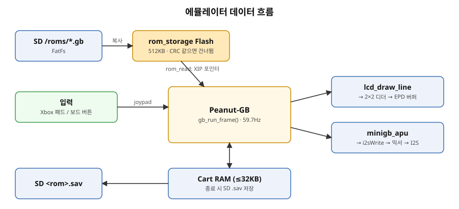

# 05. 에뮬레이터



## Phase 3 결과 (2026-11-20)

### 최종 선택: Walnut-CGB, GB(DMG) 전용 빌드

| 코어 | 결과 |
|---|---|
| **Walnut-CGB** (Peanut-GB 포크, MIT) | **채택.** GB 전용 빌드 기본, `GB_CGB_SUPPORT=1` 이면 GBC 지원 |
| Peanut-GB (MIT) | Walnut 과 속도 동일 (아래 표). 별도 이점이 없어 제거 |
| gnuboy (GPL-2, 이전 Teensy41 포팅) | CPU 코어만 이식해 시험했으나 실행 중 폴트 → 제외 |

### 속도 측정 (nRF52840 64MHz, 화면 출력 없이 `gb bench`)

| 게임 / 설정 | 프레임 시간 | 원래 속도 대비 |
|---|---|---|
| Super Mario Land, CGB 지원 빌드 | 23.5ms | 71% |
| Super Mario Land, **GB 전용 빌드** | 15.4ms | **108%** |
| Super Mario Land, GB 전용 + frame skip | 10.4ms | **160%** |
| Donkey Kong ('94), GB 전용 | 44.6ms | 37% |
| Donkey Kong, GB 전용 + frame skip | 37.3ms | 44% |
| GBMARIO (GB Studio 컬러 전용, CGB 빌드) | 40.0ms / skip 27.3ms | 42% / 61% |
| cpu_instrs (CGB 배속, 최악 조건) | 64.1ms | 26% |

- 게임마다 차이가 크다. Super Mario Land 는 대부분 HALT 로 VBlank 를 기다려 가볍고, Donkey Kong 은 CPU 를 쉬지 않고 써서 무겁다(GB 명령어 하나당 약 260 사이클).
- 라인 렌더링(`__gb_draw_line`)이 SML 기준 프레임 시간의 약 1/3. EPAPER 는 8fps 안팎이므로 **보낼 프레임만 렌더링**한다(Phase 4).
- GBC 지원 빌드는 흑백 게임도 30% 이상 느려진다(메모리 접근마다 CGB 분기). 컬러 전용 GB Studio 게임은 흑백 모드로 다시 빌드하는 것을 권장.

### 시도했지만 효과가 없었던 것

| 시도 | 결과 |
|---|---|
| `-O3` | 71% → 68%, 코드가 커져 오히려 느림 |
| 핵심 함수 RAM 실행(`.ramfunc`) | 이득 없음. Cortex-M4 는 RAM 에서 코드와 데이터가 같은 버스를 써서 Flash(+캐시) 실행이 낫다. MPU 정렬로 `.ramfunc` 가 64KB 로 부푸는 문제도 있음 |
| `long_call` 속성 | Flash 경로까지 간접 호출이 되어 107% → 84% 로 느려짐 (원인 파악 후 제거) |
| ROM 읽기 콜백 → 포인터 직접 읽기 매크로 | DK 기준 약 5% 개선 (유지) |
| 온도 등 코어 옵션(single/dual fetch) | 차이 없음 |

### walnut_cgb.h 수정 사항

`[nu40dk-kit]` 주석으로 표시했다.
- `WGB_ROM_READ/16/32` 매크로: ROM 읽기를 콜백 대신 포인터 직접 읽기로 바꿀 수 있게 함. 기본값은 원래 콜백
- `WGB_HOT` 속성 자리: RAM 실행 실험용. 기본은 비어 있음
- 사용 버전: Mr-PauI/Walnut-CGB `a42c186` (2026-08-17)

## 처음 검토: Game Boy (DMG) — Peanut-GB + minigb_apu

| 후보 | RAM | 판단 |
|---|---|---|
| **Peanut-GB** (MIT, 헤더 하나) | 약 20KB | **선정.** ROM을 콜백으로 읽고, 화면을 라인 단위 2bit로 출력 |
| gnuboy (기존 포팅, GPL-2) | 약 510KB 정적 (`patpix` 256KB 등) | RAM 부족 |
| pNesX (NES, 기존 포팅) | 약 70KB | 라이선스 불명확, 컬러→회색 변환 필요 → 추후 옵션 |
| Doom / fMSX / fake86 | MB 단위 | 불가 |

**GB를 고른 이유**
- 원래 4단계 회색이라 흑백 EPAPER와 잘 맞는다.
- 2배 확대(320×288)가 400×300 안에 들어가고 2×2 디더로 4단계를 그대로 표현할 수 있다.

## 기존 포팅 참고

| 항목 | 위치 |
|---|---|
| gnuboy 포팅 (가장 깔끔) | `Teensy41/emul_gnuboy/src/ap/gnuboy/sys/orocaboy` |
| 입력 매핑 (`pad_set`) | `esp32-s3-boy_fw/fw/s3-boy-gnuboy/main` |
| 파일 목록 (`filer.c`) | `esp32-s3-boy_fw/fw/s3-boy-gnuboy/main/ap/gnuboy/src/port/filer.c` |

## ROM 로딩

1. 런처에서 SD 카드 `/roms/*.gb`를 고른다.
2. 헤더 CRC를 비교해 `rom_storage` Flash 파티션에 이미 같은 ROM이 있으면 건너뛴다.
3. 다르면 Flash를 지우고 복사한다(진행률 표시).
4. Peanut-GB의 `rom_read(addr)` 콜백은 XIP 포인터 `rom_base[addr]`를 반환한다.
5. Cart RAM은 RAM 버퍼(최대 32KB)에 두고, 게임 종료 시 SD에 `<rom>.sav`로 저장한다.

## 폴더 구조

```
src/ap/modules/emul/
├── gb/                 공통부 (코어와 무관)
│   ├── gb_config.h     GB_CGB_SUPPORT, LCD 크기, cart RAM 크기
│   ├── gb_core.h       코어 인터페이스 (load / run_frame / joypad / frame_skip / 라인 콜백)
│   ├── gb_emul.c/h     CLI, LCD 2bpp 버퍼, bench
│   └── gb_rom.c/h      SD /roms → Flash rom_storage 복사, 목록
└── core/               에뮬레이터 코어 (gb_core.h 구현)
    └── walnut/         Walnut-CGB (walnut_cgb.h, LICENSE, core_walnut.c)
```

## CLI

| 명령 | 동작 |
|---|---|
| `gb info` | Flash 의 ROM 헤더 (제목, CGB 플래그, MBC, 크기), 코어 정보 |
| `gb list` | SD `/roms` 의 .gb/.gbc 목록 (번호 포함, macOS `._` 파일 제외) |
| `gb load <번호\|이름> [force]` | SD → Flash 복사. 같은 ROM 이면 생략, 4KB 단위 쓰기 후 검증. 512KB 약 23초 |
| `gb bench <frames> [nolcd] [skip]` | 화면 없이 에뮬레이션 속도 측정 |
| `gb show [frames]` | LCD 버퍼를 문자(40×18)로 출력 |

## 실행 구조

| 항목 | 내용 |
|---|---|
| 에뮬 스레드 | 59.7Hz 프레임 단위로 `gb_run_frame()` 실행 |
| 화면 | `lcd_draw_line(line, pixels[160])` 콜백 → 2×2 디더 → EPD 1bpp 버퍼 |
| 표시 | 디스플레이 스레드가 BUSY가 풀릴 때마다 최신 프레임만 부분 갱신 (에뮬 속도와 분리) |
| 프레임 스킵 | 표시하지 않을 프레임은 라인 렌더링 생략 (CPU 절약) |

## 성능 리스크와 대응 (Phase 3에서 확인)

64MHz Cortex-M4에서 GB를 원래 속도로 돌릴 수 있는지가 가장 큰 불확실성이다. `gb bench`로 화면 없이 측정한 뒤 다음 순서로 대응한다.

1. 렌더 스킵 (`frame_skip`, 인터레이스 옵션)
2. `-O2`/`-O3`, Peanut-GB 빌드 옵션 조정
3. CPU 핫루프를 RAM에서 실행 (`__ramfunc`)
4. 그래도 부족하면 저속 실행을 허용 (EPAPER 특성상 체감 영향이 작음)


