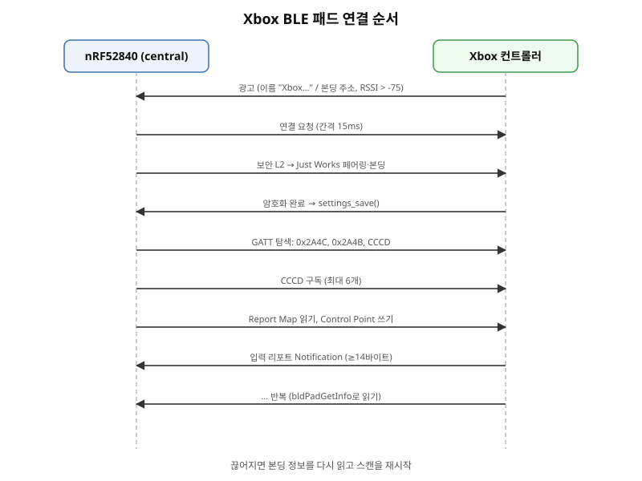

# 06. 입력: Xbox BLE 패드와 보드 버튼



## Xbox BLE 패드 (`src/ap/modules/remote/ble_pad.c`, 10_xbox에서 이전)

### 연결 흐름

1. `bt_enable` → `settings_load` (본딩 정보 복원)
2. 액티브 스캔 (interval = window = 60ms)
3. 광고 이름에 `"Xbox"`가 있거나 본딩된 주소이고, RSSI > -75이면 연결 대상으로 고른다.
4. `bt_conn_le_create` (연결 간격 15ms)
5. `bt_conn_set_security(L2)` → Just Works 페어링·본딩
6. GATT 탐색: HID Control Point(0x2A4C), Report Map(0x2A4B), CCCD 구독
7. 활성화: Report Map 읽기 → Control Point 쓰기 → 연결 완료
8. Notification(길이 14 이상)으로 입력 리포트 수신
9. 끊기면 다시 스캔

### 공개 API

```c
bool bldPadIsConnected(void);
bool bldPadGetInfo(xbox_hid_report_t *p_report);   // mutex로 복사
```

`xbox_hid_report_t`의 구성은 다음과 같다.
- 스틱 4축: `uint16`, 중심 약 32768
- 트리거 2개: 0~1023
- D-pad: hat 0~8
- 버튼: A, B, X, Y, LB, RB, View, Menu, Xbox, LS, RS

### Phase 5에서 할 일

- 런처용 API 추가: 스캔 시작/중지, 상태 조회(스캔 중, 연결 중, 연결됨, 신호 세기), 본딩 삭제
- 기존 문제 수정
  - BT 콜백 안의 `delay()`를 workqueue로 옮김
  - `blepad clear` 구현
  - `cliAdd`가 `CLI_USE(HW_SD)`로 잘못 감싸져 있는 것 수정
  - `ble_pad_conn` 중복 선언 정리
  - keepalive 타이머 사용 여부 결정

## 보드 버튼 4개

| 버튼 | 핀 | 런처 | 게임 중 (패드 없을 때) |
|---|---|---|---|
| BTN1 | P0.31 | 위 | 방향 (설정에 따라) |
| BTN2 | P1.07 | 아래 | |
| BTN3 | P1.06 | 선택/실행 | A |
| BTN4 | P1.05 | 뒤로/메뉴 | 게임 메뉴 |

API: `buttonGetPressed(ch)`, `buttonEventGetPressed/Released/Repeat` (반복 입력 지원)

## Xbox → Game Boy 키 매핑

| Xbox | Game Boy |
|---|---|
| D-pad / 왼쪽 스틱 | 방향키 |
| A | A |
| B (또는 X) | B |
| View | Select |
| Menu | Start |
| Xbox 버튼 | 게임 메뉴 (세이브, 런처 복귀) |
