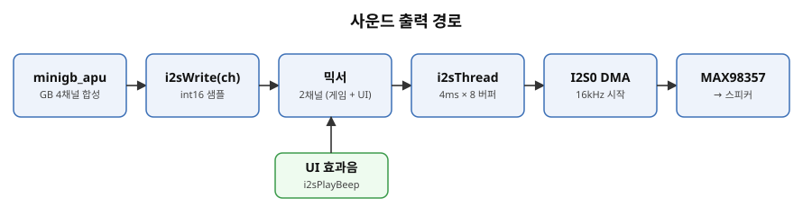

# 07. 사운드



## 하드웨어

| 항목 | 내용 |
|---|---|
| 앰프 | MAX98357 (I2S 입력 모노 Class-D, 코덱 없음) |
| 핀 | SCK P1.09, LRCK P1.08, SDOUT P0.19, MUTE(SD) P1.10 |
| 포맷 | 16bit 스테레오 I2S (앰프가 L/R 믹스) |

## 소프트웨어 경로 (기존 04_i2s 드라이버 재사용)

```
minigb_apu (GB 4채널 합성)
   └→ int16 샘플 → i2sWrite(ch) → 믹서(2채널) → i2sThread → I2S DMA → MAX98357
```

| 항목 | 값 |
|---|---|
| 믹서 채널 | 2 (게임 1 + UI 효과음 1) |
| 버퍼 | 4ms 프레임 × 8개 = 32ms |
| 샘플레이트 | 16kHz 시작, CPU 여유를 보고 22.05k / 32.768kHz 검토 |
| API | `i2sGetEmptyChannel`, `i2sAvailableForWrite`, `i2sWrite`, `i2sSetSampleRate`, `i2sSetVolume`, `i2sPlayBeep` |

## 확인 방법 (Phase 6)

- `i2s beep`, `i2s melody`로 기본 출력을 확인한다.
- 게임 BGM과 효과음이 끊김 없이 나오는지 확인한다.
- 오디오를 켠 상태로 `gb bench`를 돌려 CPU 여유를 확인한다. 부족하면 샘플레이트를 낮춘다.
