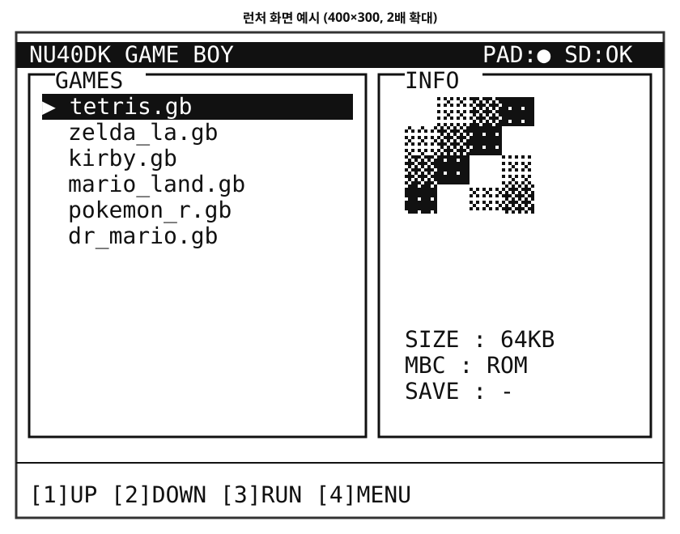

# 08. 런처



## Phase 7 구현 (2026-11-20, `src/ap/modules/launcher/launcher.c`)

| 항목 | 내용 |
|---|---|
| 실행 위치 | 메인 스레드 (`apMain()` → `launcherMain()`), 우선순위 6 (`CONFIG_MAIN_THREAD_PRIORITY`). 기본 0 이면 그리기 중 I2S 언더런 |
| 화면 | MAIN / GAMES / CONTROLLER / SETTINGS / INFO, 게임 중 PAUSE 메뉴 |
| 갱신 | 메뉴 이동 = `EPD_MODE_PART` (공장 웨이브폼 약 0.6초), 30회마다 FULL, 부팅·게임 종료 후 첫 화면 = `epdUpdateStrong()` (3색 웨이브폼 2.8초), 3초 입력 없으면 `epdPowerOff()` |
| 입력 | 엣지 + 위/아래/좌/우 자동 반복 (400ms 후 120ms 간격). 보드 BTN1~4, 패드 D-pad·왼쪽 스틱·A/Menu(OK)·B/Xbox(BACK) |
| ROM 실행 | `gbRomLoad()` (진행 막대 0.7초마다) → 세이브 읽기 → `gbRunStartEx(false)` |
| 게임 메뉴 | RESUME / SAVE & QUIT / RESET / QUIT (NO SAVE). 게임 화면 위에 상자로 그림 |
| 세이브 | 배터리 백업 카트리지만 `/saves/<ROM 이름>.sav` (`gbGetSaveSize()`, `gbSaveRead/Write()`) |
| 설정 | Zephyr settings `game/cfg`: 사운드, 볼륨, 화면 품질(FAST 펄스 10/7/5/3) |

### Phase 7 에서 발견한 문제

| 문제 | 원인 | 수정 |
|---|---|---|
| 아무것도 안 눌러도 메뉴 선택 바가 계속 움직임 | 패드가 스틱 데이터를 보내기 전 보고서가 0 → "왼쪽 위로 꺾음" | 보고서 초기값의 스틱을 중앙(32768)으로 (`blePadResetReport`). 게임 입력에도 같은 문제가 있었음 |
| 런처 배경에 마리오 화면이 겹쳐 보이고 배경이 회색 | **FAST 모드 hold 구동**: 변하지 않은 픽셀까지 초당 7번씩 같은 방향 전압을 걸어 패널에 DC 가 누적 (InkBoy 는 변하지 않은 픽셀을 구동하지 않음) | 게임 FAST 의 hold = 0, 런처는 공장 웨이브폼만 사용, 첫 화면은 강한 갱신 |
| INFO 화면에서 멈춤 | EPD BUSY 가 풀리지 않아 대기 (5초 제한) | `epdRecover()`: BUSY 제한시간 초과 시 하드웨어 리셋 + 재초기화, 원인 추적 로그 (`epd info` 의 recover 횟수) |

### 남은 문제

- 장시간 hold 구동으로 생긴 마리오 잔상은 `CLEAN SCREEN`(3색 검정/흰색 반복)을 여러 번 해도 옅게 남는다. 패널 내부 전하가 빠지는 데 시간이 걸리는 것으로 보이며, 영구 잔상일 가능성도 있다.

## LVGL 검토 결과: 사용하지 않음

| 항목 | 판단 |
|---|---|
| RAM | LVGL은 최소 32KB 이상과 그리기 버퍼가 필요하다 |
| 장점 활용 | EPAPER는 흑백이고 갱신이 느려서 애니메이션, 컬러, 위젯의 장점이 거의 없다 |
| 대안 | 기존 런처의 `menu_node_t` 트리 구조를 1bpp 텍스트 UI로 이식한다 (`esp32-s3-boy_fw/fw/s3-boy-launcher/main/ap/launcher/launcher.cpp`) |

## UI 스타일: 레트로 터미널 (DOS/BIOS 느낌)

| 항목 | 내용 |
|---|---|
| 글꼴 | 8×16 고정폭 (한글 16×16, 기존 `hangul` 폰트 재사용) |
| 격자 | 50열 × 18줄 (+ 남는 12px은 여백) |
| 배경 | 흰 배경에 박스 테두리 |
| 반전 영역 | 상단 바(제목, 패드 상태)와 선택 바만 |
| 하단 | 보드 버튼 안내 `[1]UP [2]DOWN [3]RUN [4]MENU` |
| 오른쪽 패널 | 디더링한 타이틀 썸네일, ROM 크기와 MBC, 세이브 유무 |

### 갱신 규칙 (EPAPER 특성 반영)

- 텍스트 셀 버퍼와 더티 줄을 추적해, 바뀐 줄의 사각 영역만 부분 갱신한다.
- 깜빡이는 커서와 애니메이션은 쓰지 않는다. 깜빡일 때마다 갱신이 일어나기 때문이다.
- 화면을 전환할 때나 N회 이동한 뒤에는 전체 갱신으로 잔상을 정리한다.

## 메뉴 구조

```
MAIN
├── GAMES        SD /roms/*.gb 목록 → 선택 → Flash 복사(진행률) → 실행
├── CONTROLLER   스캔/연결, 상태(RSSI, 배터리), 페어링 삭제
├── SETTINGS     디더 방식, 갱신 모드, 잔상 정리 주기, 볼륨
└── INFO         펌웨어 버전, 메모리, SD 상태
```

## 조작

| 입력 | 런처 |
|---|---|
| BTN1 / D-pad 위 | 위로 |
| BTN2 / D-pad 아래 | 아래로 |
| BTN3 / A | 선택·실행 |
| BTN4 / B | 뒤로 |
| 게임 중 Xbox 버튼 또는 BTN4 길게 | 게임 메뉴 (세이브 후 런처 복귀) |

## 확인 방법 (Phase 7)

패드 없이 보드 버튼만으로 다음 흐름이 모두 동작해야 한다.
- ROM 선택 → 플레이 → 런처 복귀 → 패드 재연결
