# 10. 회색 모드 카메라 캘리브레이션

게임 화면 회색 모드(ink 모드)의 펄스 수 표(`gray_dose`)를 카메라로 패널을 찍어 맞춘 방법과 결과를 정리한다 (2026-11-20).

## 1. 왜 필요한가

### 회색 모드가 회색을 만드는 방식

EPAPER 픽셀은 마이크로캡슐 안의 검은 입자와 흰 입자로 되어 있다. 픽셀 전극에 전압을 걸면 입자가 위아래로 움직이고, 얼마나 움직였는지가 그 픽셀의 밝기가 된다.

- 공장 웨이브폼은 입자를 끝까지 밀어 순백 또는 순흑만 만든다.
- 회색 모드는 짧은 펄스(32ms, 커스텀 LUT 4프레임 × 8ms)를 몇 번 주고 멈춰서 입자를 **중간에 세운다**. 펄스 수가 곧 밝기다.
- 그래서 "흰색에서 연회색으로 가려면 몇 펄스" 같은 표(`gray_dose[출발][목표]`)가 필요하다. GB 4단계(W 흰, L 연회색, D 진회색, K 검정) 사이의 전환 12가지마다 값이 하나씩 있다.

### 표를 눈으로 맞추기 어려운 이유

| 성질 | 내용 |
|---|---|
| 비선형 | 같은 펄스 1개라도 출발 위치에 따라 움직이는 양이 다르다. 끝에 가까울수록 덜 움직인다 |
| 방향에 따라 다름 | 흰→검과 검→흰의 반응이 다르다. 측정해 보니 **검→흰은 첫 펄스가 거의 효과가 없다** |
| 출발점 의존 | 같은 "연회색"이라도 흰색에서 왔는지 검정에서 왔는지에 따라 밝기가 다르다. 표가 이것을 맞추지 못하면 **움직였던 자리가 얼룩(잔상)으로 남는다** |
| 패널마다 다름 | 패널, 온도, 사용 이력(이 패널은 hold 구동으로 대비가 떨어짐)에 따라 반응이 다르다 |

눈으로는 "조금 어둡다" 정도만 알 수 있어서, 12가지 전환을 고르게 맞추려면 밝기를 숫자로 재야 한다. InkBoy 도 같은 이유로 카메라로 표를 튜닝했다.

## 2. 원리

1. **보드가 측정용 화면을 그린다.** 게임과 똑같은 커스텀 LUT·펄스 길이·VCOM 으로, 패치마다 정해진 펄스 수를 준다.
2. **카메라로 패널을 찍는다.**
3. **사진에서 패치별 밝기를 뽑는다.**
   - 위치 맞춤: 화면 네 모서리의 검은 사각형(10×10)을 찾아 패널 좌표 → 사진 좌표 변환(호모그래피)을 계산한다. 카메라가 조금 비스듬해도 패치 위치를 정확히 찾는다.
   - 기준 정규화: 같은 화면에 공장 3색 웨이브폼(F7)으로 그린 **순흑 기준 패치**와 **순백 바탕**을 함께 넣고, 밝기를 0(순흑) ~ 1(순백)로 바꾼다. 카메라 자동 노출이 바뀌어도 값이 흔들리지 않는다.
   - 조명 보정: 조명이 고르지 않아 같은 흰 바탕도 왼쪽과 오른쪽이 15% 달랐다. 그래서 각 패치는 **바로 옆 흰 바탕의 밝기로 나눈 비율**(반사율)로 계산한다.
   - 잡음: 패치 가장자리 25% 를 빼고 안쪽 144점의 중앙값을 쓴다.
4. **응답 곡선과 표 검증 결과로 펄스 수를 고른다.** 목표: 같은 목표 회색은 출발 색과 상관없이 같은 밝기.

정규화 값은 카메라가 기록한 밝기(감마가 적용된 값) 기준이다. 실제 반사율과 선형 관계는 아니지만, 사람 눈의 밝기 감각에 가깝고 "출발 색이 달라도 같은 밝기인가"를 비교하는 데는 충분하다.

## 3. 측정 화면 (펌웨어 CLI)

게임이 멈춘 상태에서 실행한다. ink 마스크 버퍼(`gbRunGetScratch`)를 빌려 쓰므로 게임 중에는 거부한다.

### `gb cal [frames=4] [max=10]`: 응답 곡선

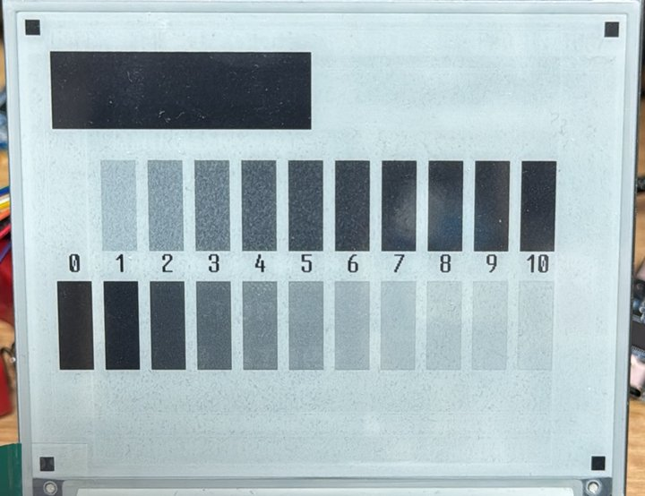

| 영역 | 내용 |
|---|---|
| 기준 | 3색 강한 갱신(F7)으로 흰 바탕, 왼쪽 위 순흑 기준 패치(176×50), 아래 줄 패치 검정 |
| 위 줄 (y 90~149) | 흰색에서 검정 쪽으로 패치 k 에 펄스 k 개 (0~10) |
| 아래 줄 (y 170~229) | 검정에서 흰색 쪽으로 패치 k 에 펄스 k 개 |

펄스 i 번째 스캔에서는 k ≥ i 인 패치만 구동한다 (`epdUpdateMask`, 게임과 같은 함수). 패치 폭 24px, 간격 32px (바이트 단위로 정렬).

### `gb caltable [frames=4]`: 펄스 표 검증

| 영역 | 내용 |
|---|---|
| 배치 | 4줄(출발 W/L/D/K) × 4칸(목표 W/L/D/K), 패치 48×24, 줄 간격 38 |
| 기준 | F7 으로 흰 바탕, K 줄 패치 검정 |
| 1단계 | L·D 줄 패치를 흰색에서 **지금 펄스 표대로** L·D 로 만든다 |
| 2단계 | 각 패치를 **지금 펄스 표대로** 목표 색까지 전환한다 |

같은 칸(목표)의 네 패치가 같은 밝기면 표가 잘 맞은 것이다. `gb dose <from> <to> <n>` 으로 표를 바꾸고 다시 실행해 비교한다.

## 4. 측정 방법

| 항목 | 내용 |
|---|---|
| 카메라 | 아이폰(연속성 카메라)을 패널 정면 약 20cm 에 고정. 1920×1080. 웹캠(Logitech StreamCam)도 사용 가능 |
| 촬영 | `imagesnap -d "<카메라 이름>" -w 2 photo.jpg` (`brew install imagesnap`, 처음 한 번 카메라 권한 허용) |
| 분석 | `tools/cal/measure_curve.py`, `tools/cal/measure_table.py` (Python 3 + numpy + Pillow) |
| 한 번에 | `tools/cal/capture.sh curve|table [frames] [카메라]`: CLI 실행 → 촬영 → 분석. 되돌림·머문 시간은 `measure_grid.py`, 움직임 잔상은 `move.sh` |
| 반복성 | 같은 화면 두 번, 다시 그린 화면 한 번: 차이 0.02 이내 (반사광이 있는 패치만 0.05) |

조건: 카메라·보드를 고정하고, 패널에 조명 반사가 없는 각도로 둔다. 모서리 사각형의 대략 위치가 기본값(1920×1080, 패널이 가운데)과 다르면 스크립트 두 번째 인자로 준다.

## 5. 결과

### 응답 곡선 (32ms 펄스, 0 = 순흑 기준, 1 = 순백 기준)

| 펄스 수 | 0 | 1 | 2 | 3 | 4 | 5 | 6 | 7 | 8 | 10 |
|---|---|---|---|---|---|---|---|---|---|---|
| 흰 → 검 | 1.00 | 0.80 | 0.59 | 0.43 | 0.28 | 0.18 | 0.13 | | ~0.06 | 0.05 |
| 검 → 흰 | 0.02 | **0.00** | 0.16 | 0.36 | 0.56 | 0.67 | 0.79 | 0.86 | 0.89 | 0.95 |

- 흰→검은 펄스당 약 0.2씩 어두워지다가 5펄스 이후 포화된다.
- 검→흰은 **첫 펄스가 효과가 없고**(입자가 움직이기 시작하는 데 1펄스), 그 뒤 펄스당 약 0.2씩 밝아진다. 순백(F7)까지는 10펄스로도 0.95.

### 펄스 표 검증

| 이전 표 | 새 표 |
|---|---|
| 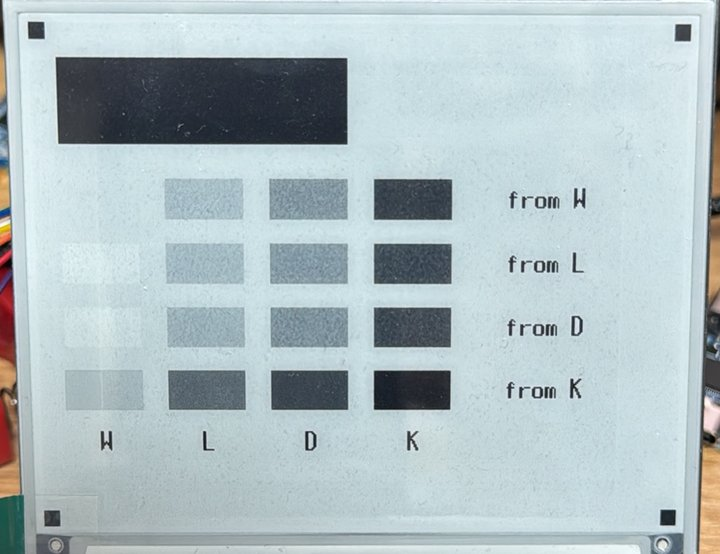 | 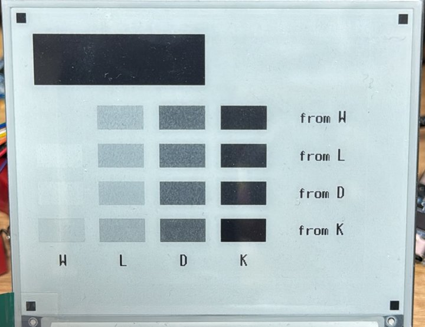 |

이전 표 `{W: 0 1 2 6, L: 5 0 1 4, D: 6 1 0 3, K: 7 3 2 0}` 의 측정값:

| 출발 \ 목표 | W | L | D | K |
|---|---|---|---|---|
| W | 0.99 | 0.79 | 0.57 | 0.12 |
| L | 1.05 | 0.78 | 0.59 | 0.16 |
| D | 1.03 | 0.75 | 0.56 | 0.16 |
| K | 0.85 | **0.35** | **0.14** | -0.03 |
| 차이 | 0.20 | **0.43** | **0.45** | 0.04 |

검정에서 온 연회색(0.35)이 흰색에서 온 진회색(0.57)보다 어두웠다. 같은 목표라도 출발점에 따라 다른 밝기가 되어, 움직였던 자리가 얼룩으로 남는 원인이었다.

새 표 (곡선에서 1차 계산 → 측정 → K 줄 2곳 조정):

| 출발 \ 목표 | W | L | D | K |
|---|---|---|---|---|
| W | – | 1 | **3** | **7** |
| L | **3** | – | **2** | **6** |
| D | **5** | **2** | – | **4** |
| K | **10** | **6** | **3** | – |

새 표의 측정값:

| 출발 \ 목표 | W | L | D | K |
|---|---|---|---|---|
| W | 1.00 | 0.79 | 0.40 | 0.09 |
| L | 1.03 | 0.78 | 0.42 | 0.11 |
| D | 1.00 | 0.81 | 0.37 | 0.11 |
| K | 0.93 | 0.76 | 0.34 | -0.02 |
| 차이 | 0.11 | **0.05** | **0.08** | 0.02 |

같은 목표의 밝기 차이가 연회색 0.43 → 0.05, 진회색 0.45 → 0.08 로 줄었다. 4단계 평균 밝기는 W 0.99, L 0.79, D 0.38, K 0.10.

### 1차 표를 고른 방법

- 흰색·검정에서 출발하는 전환: 응답 곡선에서 목표 밝기에 가장 가까운 펄스 수.
- 회색에서 출발하는 전환: 출발 회색이 곡선 위 어디(몇 펄스 지점)에 있는지 보고, 같은 방향 곡선에서 목표까지 남은 펄스 수. 예: L(0.79)은 흰→검 곡선의 1펄스 지점, D(0.40)는 3펄스 지점이므로 L→D 는 2펄스.
- 측정 후 차이가 큰 K→L(5 → 6), K→W(8 → 10)를 조정했다.

## 6. 되돌림·머문 시간 측정과 움직임 잔상 시험

### `gb calrev [frames] [dir]`: 전환 도중 되돌아오기

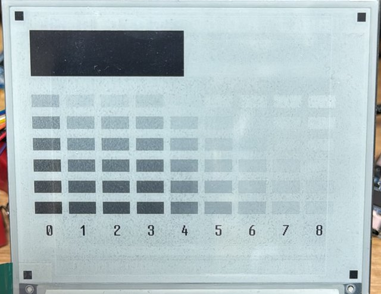

흰 바탕에서 줄 k(1~6) 만큼 검정 쪽 펄스를 준 뒤 바로 칸 m(0~8) 만큼 흰색 쪽 펄스. 스크롤 중 얇은 선처럼 "가다가 되돌아오는" 픽셀.

| k \ m | 0 | 1 | 2 | 3 | 4 | 5 | 6 | 7 | 8 |
|---|---|---|---|---|---|---|---|---|---|
| 1 | 0.80 | 0.92 | 0.93 | 0.91 | **0.99** | 1.03 | | | |
| 2 | 0.64 | 0.77 | 0.79 | 0.78 | 0.90 | **0.98** | 1.00 | | |
| 3 | 0.46 | 0.62 | 0.62 | 0.62 | 0.81 | 0.93 | **0.97** | | |
| 4 | 0.32 | 0.46 | 0.45 | 0.44 | 0.67 | 0.88 | 0.94 | **0.98** | |
| 6 | 0.18 | 0.24 | 0.25 | 0.25 | 0.55 | 0.75 | 0.88 | 0.95 | **0.98** |

- 되돌릴 때 **2·3번째 펄스가 거의 효과가 없다**. 검정 쪽으로 밀던 입자가 관성으로 계속 움직이는 것을 상쇄하는 데 쓰이는 것으로 보인다.
- 흰색으로 돌아오려면 **k + 3 펄스** 필요. 받은 만큼만 되돌리는 retarget 근사(A안, k 펄스)가 잔상을 늘린 이유 (k = 3 → 0.62).
- 지금 펌웨어(보정 끔)는 되돌릴 때 표 값(K→W 10)을 그대로 줘서 충분하다.

### `gb caldwell [frames] [black]`: 검정에 머문 시간

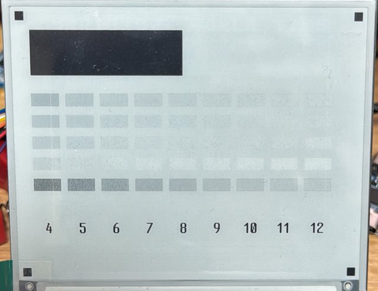

줄 0~3: 흰색에서 7 펄스로 검정을 만든 뒤 10 / 3 / 1 / 0 초 머묾. 줄 4: 공장 파형(F7) 검정. 그 뒤 칸마다 흰색 쪽 펄스 4~12.

| 머문 시간 | 4 | 5 | 6 | 7 | 8 | 9 | 10 | 12 |
|---|---|---|---|---|---|---|---|---|
| 0 초 | 0.90 | **0.97** | 0.99 | 1.03 | | | | |
| 1 초 | 0.87 | 0.92 | 0.94 | **0.97** | 0.98 | 1.00 | | |
| 3 초 | 0.84 | 0.88 | 0.92 | 0.95 | **0.96** | 0.97 | 0.97 | 1.01 |
| 10 초 | 0.76 | 0.84 | 0.87 | 0.89 | 0.93 | 0.95 | **0.97** | 0.99 |
| F7 검정 | 0.53 | 0.64 | 0.72 | 0.79 | 0.82 | 0.87 | 0.90 | 0.94 |

**오래 머문 픽셀일수록 흰색으로 덜 돌아온다.** 멈췄다 다시 움직이면 그 자리에 잔상이 남던 원인.

### `gb calmove`: 움직이는 패턴으로 잔상 측정

게임 대신 테스트 패턴을 GB 화면에 넣고 **게임과 같은 화면 처리(ink 모드)**로 보여 준다.

| 항목 | 내용 |
|---|---|
| 패턴 | 흰 바탕, GB 네 모서리 4x4 검정(위치 표시), 1px 산 윤곽선(K), 구름(L 채움 + D 테두리), 검정 상자. `big=1` 이면 2px 산, 40x16 구름, 24x24 상자 (측정 잡음 감소) |
| 움직임 | `gb calmove [speed=1] [move=40] [pause=120] [reps=3] [big=0]`: speed px/프레임으로 move 프레임 이동 → pause 프레임 멈춤을 reps 번. 기본은 40px 이동, 2초 멈춤, 3번 |
| 기준 사진 | `gb calclean` (3색 강한 갱신으로 흰 화면, 런처 정지) 후 촬영. 패턴 후 사진과 **GB 픽셀마다 비율**로 비교해 원래 얼룩·조명·이전 화면 잔상을 상쇄 |
| 잔상 값 | 1 - (패턴 후 / 기준). 노출 차이는 안 지나간 아래 띠를 1로 맞춰 보정. 0 = 깨끗 |
| 점수 | STOP GHOST = 멈췄던 두 위치(40, 80px)의 상자·구름·선 평균. GHOST SCORE = 지나간 영역 전체 평균 |
| 자동화 | `tools/cal/move.sh <label> [calmove 인자]` (정리 갱신을 끄고 기준 촬영 → 패턴 → 촬영 → 분석), 잔상 지도 `<photo>.residue.png` |
| 잡음 | 안 지나간 영역 평균 0.005~0.006 |

측정 중에는 런처가 화면을 그리지 않는다 (`gbRunSetExtBusy`). 처음 측정에서 10초 기다리는 사이 런처가 패드 상태(배터리)를 다시 그려 측정 화면을 덮은 일이 있었다.

### settle 보너스

바뀌는 순간 남은 펄스가 0 인 픽셀(도착해서 머물던 픽셀)이 흰색으로 갈 때만 펄스를 더 준다 (`gb settle <L> <D> <K>`). 움직이는 중인 픽셀(남은 펄스 > 0)은 해당하지 않아 과구동되지 않는다. RAM 추가 없음.

| | 패턴 후 | 잔상 지도 |
|---|---|---|
| settle 0/0/0 | 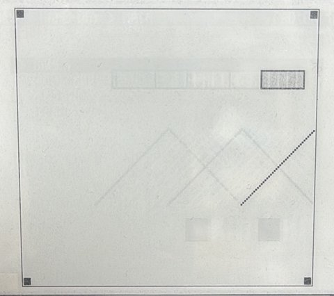 | 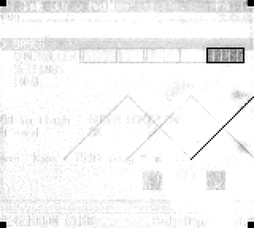 |
| settle 1/2/3 | 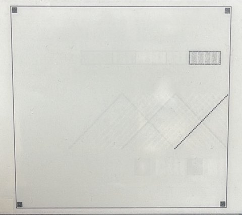 | 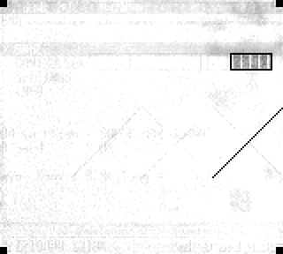 |

| settle (L/D/K) | 멈췄던 자리 잔상 (작은 도형) | 큰 도형 | 너무 하얘짐 (흰 자국) |
|---|---|---|---|
| 0 / 0 / 0 | 0.029 | 0.026 | 0.002 |
| **1 / 2 / 3 (기본값)** | **0.010** | **0.009** | 0.009 |
| 2 / 3 / 5 | 0.007 | | 0.014 |

2/3/5 는 잔상은 더 줄지만 멈췄던 자리가 주변보다 하얘져, 둘의 합이 가장 작은 1/2/3 을 기본값으로 했다.

### 가장자리 보너스와 최종 설정

settle 1/2/3 에서도 멈췄던 자리의 **테두리 잔상이 안쪽의 2~3배** 남았다 (큰 도형: 테두리 0.012~0.016, 안쪽 0.005~0.007). 구동하는 픽셀 옆에 구동하지 않는 흰 픽셀이 있으면 경계에서 전기장이 옆으로 새어 테두리 픽셀이 덜 움직이는 것으로 본다. 또 어두운 색일수록(검정 > 진회색 > 연회색) 잔상이 크다.

- **edge 보너스** (`gb edge <n>`): settle 대상 픽셀 중 상하좌우 이웃이 원래 더 밝았던 픽셀(물체의 테두리였던 픽셀)에 n 펄스 추가. inkPlan 이 이전 목표를 줄 안에서 덮어쓰므로 윗줄·현재 줄 복사(80 바이트)로 판단.
- K 의 settle 을 3 → 4.

| 설정 (큰 도형, 측정마다 ±0.005) | 멈췄던 자리 | 테두리 | 안쪽 | 너무 하얘짐 (기준 0.007) |
|---|---|---|---|---|
| settle 1/2/3, edge 0 | 0.016 | 0.029 | 0.014 | |
| settle 1/2/3, edge 2 | 0.011 | 0.016 | 0.007 | |
| **settle 1/2/4, edge 2 (기본값)** | **0.006** | **0.007** | **0.003** | 0.008 |
| settle 1/2/5, edge 2 | 0.007 | 0.010 | 0.004 | 0.006 |

1px·2px 의 얇은 검정 선(산 윤곽)은 아직 연하게 보인다. 선은 모든 픽셀이 테두리라 가장자리 효과가 가장 크다.

### 선 보너스와 카운터 5비트

- 펄스 카운터가 4비트(최대 15)라 검→흰 10 + 머문 4 + 테두리 2 = 16 에서 잘리고 있었다. 이 상태에서 선 보너스를 바꿔도 결과가 측정 잡음만큼만 달랐다.
- 카운터를 **5비트(최대 31)** 로 늘림 (`INK_CNT_BITS`, RAM +2.9KB, 99.2%).
- **선 보너스** (`gb thin <n>`): 밝은 이웃이 3개 이상인 픽셀(1px 선)에 n 펄스 추가 (테두리 보너스에 더해).

| 작은 도형 1px 산 윤곽 (2회 측정) | 선 잔상 | 선이 너무 하얘짐 (기준 약 0.007) |
|---|---|---|
| 4비트 카운터 (15 에서 잘림) | 0.026 | |
| 5비트, thin 0 | 0.011~0.013 | 0.004~0.013 |
| **5비트, thin 4 (기본값)** | **0.006~0.007** | 0.011~0.016 |
| 5비트, thin 8 | 0.004 | 0.024~0.026 (흰 선) |

### 검정 더 진하게

검정으로 가는 펄스를 +2 (W→K 7→9, L→K 6→8, D→K 4→6).

| 항목 | 이전 | 검정 +2 |
|---|---|---|
| 검정 K 밝기 (0 = F7 검정) | 0.09 | **0.04** |
| 출발 색별 검정 차이 | 0.03 | 0.01 |
| 멈췄던 자리 잔상 (2회) | 0.010 / 0.008 | 0.009 / 0.008 |
| 1px 선 잔상 (2회) | 0.010 / 0.006 | 0.009 / 0.010 |
| W / L / D 평균 | 0.99 / 0.79 / 0.39 | 0.99 / 0.79 / 0.39 |

검정이 깊어져도 머문·테두리·선 보너스가 흰색 쪽을 받쳐 잔상은 측정 오차 안에서 같았다. 흰색 유지도 다시 확인: 게임을 2분 그대로 두어도(초당 12 스캔) 하늘 밝기 변화 0.4~0.8%.

### 이 시점의 기본값 (약한 전압 상태에서 맞춘 값, 7 절에서 다시 정함)

| 설정 | 값 |
|---|---|
| 펄스 표 | W{0,1,3,9} L{3,0,2,8} D{5,2,0,6} K{10,6,3,0} |
| 머문 / 테두리 / 선 보너스 | 1·2·4 / 2 / 4 |

### `gb calcycle [moves=24] [period=60]`: 여러 번 오간 뒤 비교 (InkBoy B REBLACK 방식)

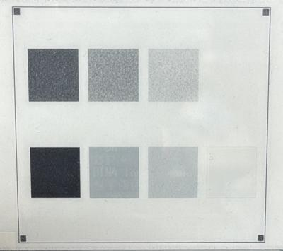

| 영역 | 내용 |
|---|---|
| 위 줄 | 고정 기준 K / D / L / W. 처음 한 번만 흰색에서 그 색으로, 이후 그대로 |
| 아래 줄 | 같은 자리 패치가 period 프레임(60 = 1초)마다 K→W→D→L 순으로 색을 바꾸며(패치마다 시작 위치 다름) moves 번 오간 뒤 위와 같은 색으로 멈춤 |
| 측정 | `tools/cal/measure_cycle.py`: 0 = 위 K, 1 = 흰 바탕으로 정규화한 위·아래 차이 |

게임과 같은 화면 처리(펄스 표, 머문·테두리·선 보너스)로 돈다.

| 색 | 고정 기준 | 24번 오간 뒤 | 차이 |
|---|---|---|---|
| K | 0.00 | -0.38 | 더 진함 |
| D | 0.42 | 0.52 | +0.11 |
| L | 0.76 | 0.70 | -0.06 |
| W | 0.98 | 0.92 | -0.06 |

여러 번 오간 픽셀은 같은 목표라도 처음 한 번 간 픽셀과 다른 회색이 된다 (이력 효과, InkBoy 의 history 보정이 다루는 것). 검정은 오갈수록 깊어지고 흰색은 덜 돌아온다. 경로별로 보정하려면 픽셀마다 이력을 기록해야 해서 RAM 이 필요하다 (8 절).

### 테스트 패턴 경쟁 조건 (수정)

처음 순환 시험에서 **바뀌지 않는 위 줄 기준이 점점 어두워졌다** (D 0.45 → 3초 0.26 → 10초 0.0). 구동 없는 스캔만 60번 돌리는 시험(`gb calzero`)에서는 회색이 변하지 않아 물리 현상이 아니었고, `gb inkdbg <y0> <y1>` (줄 범위의 남은 카운터·마스크 비트)로 보니 위 줄에 구동 대상이 주기적으로 1000~2500 픽셀씩 생겼다.

- 원인: 테스트 패턴이 매 프레임 GB 화면 버퍼를 흰색으로 지운 뒤 다시 그려서, 화면 처리 스레드가 지워진 순간을 읽으면 바뀌지 않은 패치를 흰색 ↔ 원래 색으로 계속 구동했다.
- 수정: 에뮬레이터처럼 화면 처리 쪽이 요청한 프레임에만 패턴을 그린다. 실제 게임 경로는 원래 이렇게 동작해서 해당 없음.
- 수정 후 보너스 효과 재측정 (기본값 유지 근거):

| 설정 | 작은 도형 멈춘 자리 | 1px 선 | 큰 도형 멈춘 자리 | 테두리 | 너무 하얘짐 |
|---|---|---|---|---|---|
| 보너스 모두 끔 | 0.035 | 0.052 | 0.025 | 0.037 | 없음 |
| 기본값 (머문 1/2/4, 테두리 2, 선 4) | 0.008 | 0.012 | 0.009 | 0.009 | 없음 |

## 7. 구동 전압 상태 발견과 이력 모델 (최종)

### 같은 펄스인데 게임 경로가 절반 세기

24번 오간 시험에서 고정 기준 K 가 검정이 아니라 진한 회색이었다. 원시값으로 비교하니 게임 경로가 측정용 화면보다 같은 펄스에서 약 절반 효과였다.

| 원시값 (낮을수록 검정) | 측정용 (`caltable`) | 게임 경로 (`calcycle 0`) |
|---|---|---|
| 흰→검 9 펄스 | 53 (F7 검정 47) | 89~93 |
| 흰→진회색 3 펄스 | 114 | 149~155 |
| 흰→연회색 1 펄스 | 184 | 196~198 |

원인을 차례로 배제했다.

| 가설 | 시험 | 결과 |
|---|---|---|
| 펄스 수가 적다 | `gb inkdbg` 로 남은 구동 픽셀을 시간순으로 기록 | 9 스캔 동안 구동, 수는 맞음 |
| 펄스 사이 간격 (게임 83ms) | `caltable 4 <gap>` 으로 40·100ms 간격 | 차이 없음 |
| 스캔 자체가 회색을 민다 | `gb calzero 60` (구동 없는 스캔) | 차이 없음 |
| **직전 공장 갱신의 종류** | 게임 시작 갱신을 저온 흑백(0xDF) → 3색(F7) 으로 | **K 89 → 53.5, D 149 → 110, L 197 → 177 (측정용과 같음)** |

공장 갱신은 LUT 와 함께 구동 전압(게이트·소스 전압, WS byte 228~231)을 그 모드의 값으로 바꾼다. 커스텀 펄스는 LUT 만 덮어쓰고 전압은 그대로 쓰므로, **흑백 모드 갱신(0xDF, 0xFF) 뒤에는 약하고 3색 모드 갱신(F7) 뒤에는 강하다.** 화면 구동 없이 설정만 다시 불러오는 0x22 = 0xB1·0x91·0xB9·0xF1 로는 강한 상태로 돌아가지 않았고, 3색 모드로 실제 화면을 구동하는 0xF5·0xF7 만 바꿨다 (`epd reload 1 <hex>`, `epd coldf7 1` 실험 옵션).

그때까지는 펄스 표를 F7 뒤(강함)에서 맞췄는데 게임은 대부분 약한 상태로 돌았고, 보너스는 약한 상태에서 맞췄다.

**결정: 게임 중 전체 갱신(시작·재개·장면 전환)을 F7 로 통일** (1.25초 → 2.8초). 펄스가 적게 들어 움직임 전환이 빠르고 검정이 진하다.

### 강한 전압에서 생긴 흰 자국

강한 전압이 되자 약한 상태에서 맞춘 흰색 쪽 펄스·보너스가 과해 **물체가 지나간 자리가 바탕보다 하얗게** 남았다 (보너스를 모두 꺼도 큰 도형 0.053).

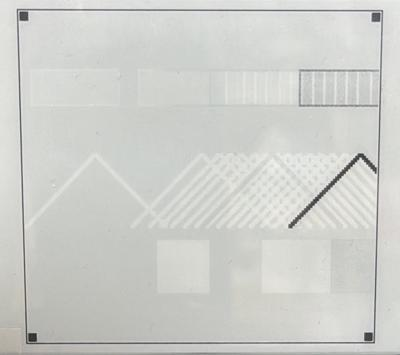

- 멈췄던 상자 자리: 흰 사각형
- 산 윤곽선이 지나간 자리: 흰 사선
- 움직이는 구름 안: **세로 흰 줄**. 화면은 GB 약 5 프레임마다 갱신되어 구름 오른쪽 테두리(D)가 5px 씩 건너뛴다. 테두리가 지나간 줄은 "흰 → (D 로 가는 중) → 바로 L" 이 되는데, D 에 도착했다고 보고 D→L(흰색 쪽 2 펄스)을 줘서 흰 줄이 됐다.

### 이력 모델 (`gb hist`, `gb dwell`)

픽셀마다 두 가지를 기록한다. USB CDC 를 빼서 RAM 9.5KB 를 확보했다.

| 기록 | 크기 | 메모리 |
|---|---|---|
| 마지막으로 안정됐던 색 S | 2비트 | 디더링 전용 `ink_base` 를 회색 모드에서 같이 씀 (추가 0) |
| dv: 이동 중이면 S 를 떠난 뒤 받은 펄스, 도착한 뒤면 머문 시간 (0.5초 단위) | 3비트 (0~7) | 8.6KB |

| 경우 | 펄스 |
|---|---|
| 머물던 픽셀이 밝은 쪽으로 | 표[o][n] + 머문 시간 보너스[o][dv] × dwell % (검정: 0, +1, +2, +2, +3, +3, +3, +4 @ 0~3.5초) |
| 이동 중 출발 색 S 로 되돌아감 | dv × hist % + hist 추가 |
| 이동 중 S 에서 본 같은 방향, 아직 n 에 못 미침 | 표[S][n] - dv |
| 이동 중 S 와 이전 목표 사이의 n 을 이미 지나침 (구름 테두리 → 안쪽) | (dv - 표[S][n]) × hist % + 추가, 방향 반대 |
| S 를 지나 반대쪽 | 되돌아감 + 표[S][n] |

도착(카운터 0)하면 그 색이 새 S, dv = 0. 0.5초마다 도착해 있는 픽셀의 dv + 1.

### 측정과 결정

| 설정 (큰 도형, 움직임 직후) | 멈춘 자리 잔상 | 너무 하얌 |
|---|---|---|
| 흰색 쪽 10/5/3, 보너스 1·2·4/2/4 (강한 전압) | 0.003 | 0.068 |
| 흰색 쪽 6/3/2, 보너스 0, 이력 끔 | 0.006 | 0.027 |
| 흰색 쪽 4/2/1, 이력 100%+1 | 0.035 | 0.007 |
| 흰색 쪽 6/3/2, 이력 100%+1, 머문 시간 100% | 0.003 | 0.028 |

흰색 쪽 펄스를 줄이면 멈춘 자리가 어둡고, 늘리면 지나간 자리가 하얗다. 머문 시간 보너스로 둘을 나눴다. 움직임이 끝나고 30초 뒤에 다시 재면 값이 ±0.02 안에서 자리마다 일정하게 치우쳤다: 오늘 같은 패턴을 같은 위치에서 수십 번 돌려 그 자리에 패널 기억이 생겨, **이 이하의 차이는 이 방법으로 가리기 어렵다.** 다음 미세 조정은 패턴 위치를 바꿔서 한다.

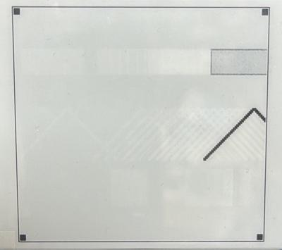

### 최종 기본값

| 설정 | 기본값 | CLI |
|---|---|---|
| 게임 중 전체 갱신 | 3색 F7 (강한 전압) | |
| 펄스 표 | W{0,1,3,9} L{**2**,0,2,8} D{**4**,2,0,6} K{**6**,6,3,0} | `gb dose` |
| 이력 보정 | 켬, 되돌림 100% + 1 | `gb hist on 100 1` |
| 머문 시간 보너스 | 50% | `gb dwell 50` |
| 머문 / 테두리 / 선 보너스 | 0 / 0 / 0 (이력·머문 시간으로 대체) | `gb settle`, `gb edge`, `gb thin` |
| 장면 전환 전체 갱신 | 40% 이상 변화 | `gb scene` |
| 조용한 순간 정리 | 끔 | `gb quiet` |
| 펄스 카운터 | 5비트 (최대 31) | |

### 회색 바탕 위 움직임 (게임에서 발견)

게임에서 마리오가 지나간 **회색 띠 자리가 하얗게** 남았다. 흰 바탕 시험만 해서 놓친 경우라 패턴을 추가했다: `gb calmove 1 40 120 3 3` (연회색 띠 위로 검정 상자), `tools/cal/measure_band.py` (지나간 띠 vs 안 지나간 띠, + 어두움 / - 하얌).

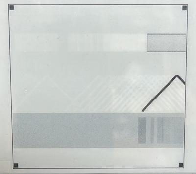

| 원인 | 수정 |
|---|---|
| 되돌아갈 때 추가 펄스(+1)와 머문 시간 보너스가 회색 목표에도 더해짐 (흰색은 끝이라 넘쳐도 안 보이지만 회색은 하얘짐) | 추가 펄스·머문 시간 보너스는 **흰색으로 갈 때만** |
| 회색은 밝아지는 쪽이 어두워지는 쪽보다 펄스당 많이 움직임 | 회색으로 되돌아갈 때 받은 펄스의 **60%** (`gb histgray`) |
| 펄스 표 K 줄은 F7 의 깊은 검정 기준인데 게임의 검정은 흰→검 펄스로 만든 얕은 검정 | `gb caltable 4 0 1` (K 줄을 펄스로 만듦)로 다시 측정: K→L 6 → **3** (0.95 → 0.76), K→D 3 → **2** |

| 회색 띠 (상자 자리) | 처음 | 수정 후 |
|---|---|---|
| 멈춘 자리 40px | -0.264 (이력 끔) | -0.047 |
| 멈춘 자리 80px | -0.203 | **-0.019** |
| 움직이며 지나간 구간 | -0.095 (이력 끔) | -0.015 |

상자가 화면 밖으로 나간 마지막 구간에는 세로 줄무늬가 조금 남는다.

### 시작할 때 바탕을 펄스 흰색으로 (`gb prewhite`)

흰 바탕에서 지나간 자리가 바탕보다 하얗게 남는 것은 **F7 의 흰색보다 펄스로 만든 흰색이 더 하얘서**다. 게임 전체 갱신(F7) 직후 캔버스에서 흰 픽셀에만 흰색 펄스를 n 번 줘서 바탕도 펄스 흰색으로 만든다 (검은 테두리는 그대로, 약 0.25 초).

| 시작 흰색 펄스 | 멈춘 자리 (어두움) | 너무 하얌 |
|---|---|---|
| 0 | 0.003 | 0.027 |
| **3 (기본값)** | 0.010 | **0.007** (기준 수준) |
| 6 | 0.014 | 0.005 |

### 최종 기본값 (갱신)

| 설정 | 기본값 | CLI |
|---|---|---|
| 게임 중 전체 갱신 | 3색 F7 + 흰 픽셀 흰색 펄스 3 | `gb prewhite 3` |
| 펄스 표 | W{0,1,3,9} L{2,0,2,8} D{4,2,0,6} K{6,**3**,**2**,0} | `gb dose` |
| 이력 보정 | 켬, 흰색으로 되돌림 100% + 1, 회색으로 되돌림 60% | `gb hist on 100 1`, `gb histgray 60` |
| 머문 시간 보너스 | 100%, 1.5 초 단위 (10.5 초까지), 흰색으로 갈 때만 | `gb dwell 100` |
| 머문 / 테두리 / 선 보너스 | 0 / 0 / 0 | |

### 머문 시간 단위 1.5 초 (게임 배경)

게임에서는 흰 자국 대신 연한 **어두운** 자국(산·구름 윤곽, 이전 블록 자리)이 남았다. 배경은 10 초 이상 머물다 스크롤로 떠나는데, 머문 시간이 0.5 초 단위 3비트라 3.5 초에서 포화하고 보너스도 50% 였다. 단위를 1.5 초(10.5 초까지)로 바꾸고 보너스를 측정값대로(검정 0, +2 @1.5 초, +3 @3 초, +4 @6 초, +5 @9 초 이상) 100% 로 했다.

`gb calmove 1 40 600 2 <big>` (10 초 멈춤) 의 첫 멈춤 자리:

| 10 초 머문 자리 | 보너스 끔 | 100% (1.5 초 단위) |
|---|---|---|
| 상자 (작은 / 큰 도형) | 0.017 / 0.040 | **0.001 / 0.002** |
| 구름 | 0.007 / 0.021 | 0.001 / 0.014 |
| 1px 산 윤곽선 | 0.006 / 0.015 | 0.006 / 0.014 |

1px 선은 테두리 효과가 커서 남는다.

## 8. 다시 맞추는 방법 (새 패널 등)

1. 카메라를 패널 정면에 고정하고 `tools/cal/capture.sh curve` 로 응답 곡선을 잰다.
2. 곡선에서 목표 밝기(W ≈ 1, L ≈ 0.75, D ≈ 0.4, K ≈ 0.1)에 맞는 펄스 수로 1차 표를 만들고 `gb dose` 로 넣는다.
3. `tools/cal/capture.sh table` 로 검증하고, 목표별 차이가 0.1 이하가 될 때까지 차이가 큰 칸을 1씩 조정한다.
4. 확정한 값을 `gb_run.c` 의 `gray_dose` 기본값에 넣는다.

## 9. 한계와 다음 단계

- 이 표는 **대비가 떨어진 지금 패널**에 맞춘 값이다. 새 패널에서는 다시 맞춰야 한다 (6절).
- 머문 시간은 3.5초에서 포화된다 (3비트). 10초 이상 머문 자리는 덜 보정된다.
- 24번 오간 시험(`calcycle`)에서 오간 진회색이 기준보다 밝다 (D +0.37). 회색끼리 오가는 경로의 보정은 아직 없다 (InkBoy 의 경로별 route 보정).
- 측정 위치에 패널 기억이 쌓여 ±0.02 이하는 구분이 어렵다.
- 회색(L, D)에 머문 뒤 다른 회색으로 가는 경우는 아직 측정하지 않았다.
- 설정을 바꿀 때는 `tools/cal/move.sh` 로 전후 점수를 비교한다.
- 같은 방법으로 화면 갱신 속도(펄스 길이 `gray_frames`)를 바꿨을 때의 표도 만들 수 있다.
