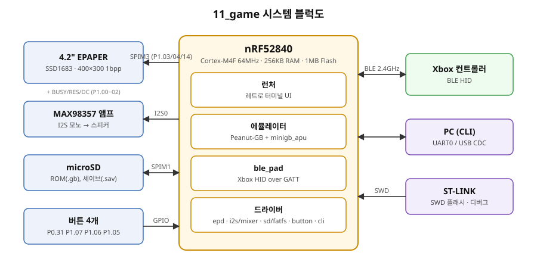

# 11_game — 4.2" EPAPER 게임기

NU40DK-KIT(nRF52840)에 WeAct 4.2" 흑백 EPAPER(SSD1683, 400×300)를 연결해 Game Boy 게임을 실행하는 프로젝트다. 조작은 BLE Xbox 컨트롤러와 보드 스위치 4개로 하고, 사운드는 I2S 앰프로 출력한다.

## 문서 목록

| 문서 | 내용 |
|---|---|
| [01_dev_env.md](01_dev_env.md) | 개발환경, 툴 버전, 빌드·플래시 방법 |
| [02_hardware.md](02_hardware.md) | MCU, 핀맵, EPAPER 연결, 주변장치 할당 |
| [03_memory.md](03_memory.md) | RAM/Flash 예산, 파티션 |
| [04_epaper.md](04_epaper.md) | SSD1683 드라이버, 고속 갱신, 디더링/회색 표현 |
| [05_emulator.md](05_emulator.md) | 에뮬레이터 선정(Peanut-GB), ROM 로딩 구조 |
| [06_input_ble.md](06_input_ble.md) | Xbox BLE 패드, 보드 버튼, 키 매핑 |
| [07_audio.md](07_audio.md) | 사운드 출력 경로 |
| [08_launcher.md](08_launcher.md) | 런처 UI(레트로 터미널), 메뉴 구조 |
| [09_optimization.md](09_optimization.md) | 최적화: 측정 도구, 에뮬·사운드·EPD, 스레드 우선순위, ink 모드(픽셀별 펄스 카운터) |

## 진행 현황

| Phase | 내용 | 상태 |
|---|---|---|
| 0 | 프로젝트 골격 (10_xbox 기반, 불필요 모듈 제거) | **완료** — 부팅·CLI·SD·I2S·Xbox 패드 연결 확인 |
| 1 | EPAPER 기본 드라이버 (SPI3, 전체 갱신, 텍스트) | **완료** — 전체 2.8초, 부분 0.6초(1.66fps), 4단계 디더 확인 |
| 2 | 고속 갱신·회색 실험 (부분 갱신, LUT, 디더) | **완료** — FAST 모드 8.4fps (커스텀 LUT), 전체 0.68초 |
| 3 | 에뮬레이터 코어 (Walnut-CGB, ROM→Flash, 벤치마크) | **완료** — GB 전용 SML 108%, DK 37%, SD→Flash 로딩 |
| 4 | 화면 연동 (라인 콜백 → 2×2 디더 → EPD) | **완료** — SML 에뮬 100%, 화면 6~7fps |
| 5 | 입력 (Xbox 패드, 보드 버튼, ble_pad 확장) | **완료** — 키 매핑, 일시정지, 스캔/페어링 API, 배터리 |
| 6 | 사운드 (minigb_apu → I2S 믹서) | **완료** — 11kHz, 무거운 장면에서 가끔 끊김 |
| 7 | 런처 (레트로 터미널 UI, ROM 목록, 컨트롤러 메뉴) | **완료** — 메뉴, 게임 메뉴, 세이브, 설정 저장 |
| 8 | 픽셀별 펄스 카운터(InkBoy 방식, 패널 보호), 에뮬 CPU 최적화, 세이브 스테이트, 저전력 | **진행 중** — ink 모드 구현 (스캔 16회/s, 정지 화면 구동 0) |

각 Phase는 보드에서 CLI로 동작을 확인한 뒤 다음 단계로 넘어간다.

## 변경 이력

| 날짜 | 내용 |
|---|---|
| 2026-11-20 | 타당성 검토, 구현 계획 수립, Phase 0 골격 생성 |
| 2026-11-20 | Phase 1 EPAPER 드라이버 (SSD1683, canvas, CLI) |
| 2026-11-20 | Phase 2 고속 갱신 (커스텀 LUT FAST 모드, SPI 16MHz) |
| 2026-11-20 | Phase 3 에뮬레이터 (Walnut-CGB GB 전용, Peanut/gnuboy 비교) |
| 2026-11-20 | Phase 4 화면 연동 (에뮬/디스플레이 스레드, 필요한 프레임만 렌더링) |
| 2026-11-20 | Phase 5 입력 (키 매핑, 일시정지, ble_pad API, 배터리) |
| 2026-11-20 | Phase 6 사운드 (minigb_apu 11kHz, I2S 복구, EPD 전송 4KB 분할) |
| 2026-11-20 | Phase 7 런처 (레트로 터미널 UI, 게임 메뉴, 세이브, 설정), FAST hold 끔 |
| 2026-11-20 | Phase 8 ink 모드 (블록별 펄스 카운터), 09 최적화 문서 |
